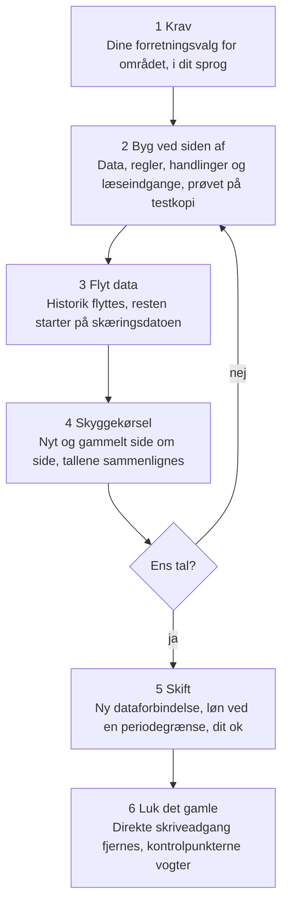
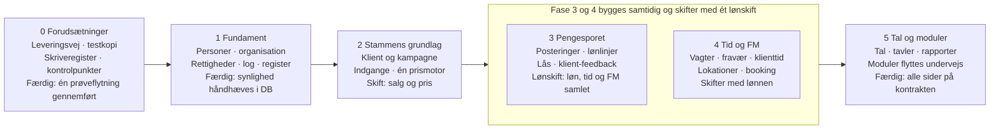

# Masterplan: strukturen under 1.0

Godkendt 19/10-2026: »jeg godkender masterplanen«

## Formål, ramme og status

Masterplanen beskriver, hvordan strukturen fra dokumentet *Storks struktur* føres ind under 1.0's UI. Det sker område for område, mens Stork kører, uden at en lønkreds rammes. Strukturen afgør, hvad der skal være. Masterplanen afgør, i hvilken rækkefølge og hvordan hvert skridt bevises.

**Grundregler for hele forløbet:**

- **Stork kører hele vejen.** Hvert område flyttes for sig, og det gamle bliver stående, indtil det nye er bevist.
- **Lønnen er hellig.** Intet, der påvirker løn, skiftes midt i en lønperiode. Det skiftes ved en periodegrænse og efter en skyggekørsel, hvor tallene er ens, eller hver afvigelse er vist i kroner og godkendt af dig.
- **Hvert skridt har et bevis**, før det næste tages. Mens ét område bevises, bygges det næste, og det, der kan bygges samtidig, bygges samtidig.
- **Alt er afgjort i planen.** Du bruger kun dine hænder ved de handlinger og godkendelser, der står i »Hvad du skal gøre«.

**Status:** godkendt 19/10-2026. Samme dag tilføjet efter din afgørelse: 2.0's sikkerhedsregler på hele databasen fra fase 0, log på alle tabeller i fase 1 og egen backup uden for Lovable (trin 0.3, 0.5, 1.1 og 1.2). Efter din godkendelse samme dag er også mangelanalysens punkter fra 2.0's fundament, forretningsforståelsen og dine afgørelser skrevet ind i trinene, og Kasper Mikkelsen er GDPR- og AI-ansvarlig. Tilføjelserne giver tilsammen ca. fem uger mere, heraf én uge til at trække beskyttelsen af CPR, bank og privat e-mail frem (20/10). Planen har 55 konkrete trin i fase 0–5. Hvert trin siger, hvad der er færdigt bagefter, hvad der er afgjort, og hvordan det bevises. Planen har været gennem tre uafhængige angrebsrunder. Den første fandt, at overgangen manglede. Den anden fandt 23 huller mellem trinene, flest i lønnens overgang. Den tredje kontrollerede rettelserne: 16 var lukket, 7 delvist, og der var 10 nye rester. De er rettet i trinene. Planen er derefter gjort mere ambitiøs: genafspilning i stedet for at vente på lønperioder, fase 3 og 4 bygget samtidig med ét lønskift og moduler flyttet undervejs. Målet er ca. 6 måneder fra go (se Tidsplan). Masterplanen ligger i mappen masterplan/ i 1.0-repoet. Repoet er offentligt, så de fire huller i 0.5 og andre åbne sikkerhedshuller beskrives der kun generelt, indtil de er lukket. Den eksisterende masterplan for 2.0 (`docs/strategi/stork-2-0-master-plan.md`) røres ikke.

## Udgangspunkt: hvad der flyttes

Under 1.0's UI skal 24 forretningsområder flyttes til strukturen. De bruger i dag 346 tabeller, 65 automatiske job og 126 edge functions. Siderne bevares, men 452 af UI'ets 988 filer taler direkte med databasen og skal have ny dataforbindelse.

| Det der flyttes | Omfang i dag |
| --- | --- |
| Sider med direkte databasekald | 452 filer; 2.481 tabelkald; 851 direkte skrivekald i 246 tabeller |
| Data, som UI'et afhænger af | 863 læseformer og 522 skriveformer, ikke beskrevet nogen steder |
| Beregninger i browseren | Løn, DB og lederløn; annulleringsfradrag og feriepenge defineret 2–3 steder |
| Salg | ca. 71.000 salg og 85.000 linjer; 6.000–9.000 nye om måneden |
| Dialer-data | ca. 1,2 mio. rækker; ca. 1,7 mio. nye om året |
| Medarbejdere | 329 (138 aktive), registreret i flere sideordnede tabeller |
| Integrationer | Adversus, Enreach, e-conomic, M365, Twilio, Meta, Zapier og fil-uploads |

Tallene er fra skemaet 7/10 og koden 15/10. Siden er der kommet flere til: 131 edge functions og 255 rettighedsnøgler. Opgørelsen opdateres før hvert skift. Antal kaldsteder i koden siger ikke, hvor ofte de bruges, og antal læse- og skriveformer siger ikke, hvor mange nye funktioner der skal til.

**Det, der allerede findes:** 2.0's fundament er bygget og godkendt: adgang, log, drift, klassifikation, identitet, anonymisering, perioder, break-glass, organisationstræ og klienter. Det kan genbruges som byggesten i strukturen, men kun som samlet sluttilstand. 2.0's migrationshistorik kan ikke afspilles i 1.0, fordi den sletter tabeller, som 1.0 bruger (`teams`, `clients`, `role_page_permissions`, `data_field_definitions`). Hvor strukturen har ændret 2.0's løsning, som i pengesporet, gælder strukturen.

**Det, der ikke findes og derfor starter på en skæringsdato:**

- historik for teams' ejerskab af klienter. 1.0 gemmer kun dagens kobling, så historikken genskabes fra sælgernes teamhistorik og fremlægges for dig som rapport (din afgørelse 16/5, trin 2.6)
- teammedlemskab med datoer
- vagter som rækker
- hvad der faktisk blev udbetalt i løn

## Sådan flyttes et område

Hvert område flyttes gennem de samme seks trin. Det gamle bliver stående, indtil det nye har vist ens tal i en skyggekørsel, eller hver afvigelse er vist i kroner og godkendt af dig. En afvigelse, der ikke er en bevidst regelændring, rettes, før der skiftes. **Det, der skifter ejer, er en forretningsenhed (fx salget), ikke en side.** Se næste afsnit om overgangen.

Porten er skyggekørslen. Er tallene ikke ens, og er forskellen ikke en godkendt afvigelse, rettes området og køres igen, og det gamle bliver stående imens.

1. **Krav:** områdets valg står allerede afgjort i trinnet med kilde. Før byggeriet kontrolleres, om 1.0 har ændret logik i området siden kortlægningen. Har den det, afgøres ændringen efter samme rækkefølge af kilder og skrives ind i trinnet.
2. **Byg ved siden af:** områdets data, regler, handlinger og læseindgange bygges i strukturen. Det gamle røres ikke. Alt prøves først på en testkopi.
3. **Flyt data:** historik flyttes fra 1.0's tabeller. Hvor historik ikke findes, starter den på skæringsdatoen. Uoverensstemmelser (dubletter, manglende koblinger) vises i den fælles oversigt og rettes før skiftet.
4. **Skyggekørsel:** data fra mindst to afsluttede lønperioder genafspilles i begge systemer, og tallene sammenlignes. Genafspilningen bruger de rådata, 1.0 allerede har gemt (fx salgenes rå payload), og 1.0's øvrige data tages fra et fastfrosset udtræk. Det, der mangler, hentes igen fra kilderne om natten i små portioner, så driftens synkronisering ikke rammer API-grænserne. Derefter kører det nye en uge live side om side med det gamle, så skrivere, job og arbejdsgange, som genafspilningen ikke viser, også er prøvet. Hver afvigelse forklares eller rettes.
5. **Skift:** områdets sider får ny dataforbindelse gennem UI-kontrakten. Det, der påvirker løn, skiftes ved en periodegrænse. Du godkender skiftet ud fra listen over afvigelser i kroner.
6. **Luk det gamle:** direkte skriveadgang til de gamle tabeller fjernes, og gamle beregninger slettes. Kontrolpunkterne tjekker løbende, at intet skriver uden om.

## Overgangen: hvem ejer data undervejs

I overgangen ejes hver forretningsenhed af ét system ad gangen: medarbejder, klient, salg, periode, vagt, booking og så videre. Ejeren er enten 1.0 eller strukturen, aldrig begge. Mange læsere er håndterbare. Flere uafhængige skrivere er det farlige. Fx skrives `sales` fra 11 filer, og `employee_master_data` fra 18.

**Skriveregistret.** Før en enhed skifter ejer, kendes alle, der skriver i den. Det gælder sider, integrationer, automatiske job, edge functions, databasefunktioner og triggere. Hver får en afgørelse: fortsætter, omlægges eller stoppes. Eksempler fra i dag:

- Integrationsmotoren sletter og genskaber salgslinjer ved synkronisering.
- Omprisningsjobbet skriver priser.
- Oprydningsjobbet sletter medarbejdere efter fem år.
- Triggere opretter FM-salgslinjer.

**Overtagelsen.** Når en enhed skifter, skifter alle dens skrivere på én gang. Direkte gamle skrivninger lukkes i samme øjeblik. Fysisk oprydning af det gamle venter til trin 6.

**Gamle læsere.** Sider, der endnu ikke er flyttet, læser videre via visninger, der ligner de gamle tabeller, eller via kopier fra strukturen. Kopieringen går kun én vej, fra ejeren til kopien. Kopiering må aldrig udløse gamle forretningshandlinger (triggere). Inden skiftet tages en sidste opsamling, så intet mangler.

**Den sidste periode i 1.0 og den første i strukturen.** 1.0 beregner og afslutter den sidste periode helt, også eksporten. Strukturen ejer alt fra skæringsdatoen. Indtil 1.0's sidste periode er låst, kan en annullering henføres til den eller til strukturens første periode. Efter låsen bliver en annullering mod den en modpost i en åben periode i strukturen. Den regnes ud fra salgets åbningsgrundlag (se skæringsdatoer).

**Tilbagevej, to slags:**

- **UI og kode** kan rulles tilbage, mens strukturen beholder dataansvaret. Det er den normale tilbagevej.
- **Dataansvaret** kan kun føres tilbage til 1.0 med en afprøvet overførsel af alt, der er sket efter skiftet. Den overførsel øves med nye data og rettelser, før skiftet. Hver enhed har en fast slutdato for, hvornår den mulighed udløber.

En backup er ikke en tilbagevej. Lovable tager kun én backup om dagen, og en gendannelse sletter alt, der er sket siden, også i områder, der ikke var flyttet.

**Ejerregistret.** Hver enhed overtages i ét trin. Senere trin bruger eller udvider den, men overtager den ikke igen.

| Enhed | Overtages i | Bruges senere af |
| --- | --- | --- |
| Karriereønsker | 0.7 | 5.9 viser dem |
| Klassifikation og opbevaringsregler | 1.1 | 2.2 henviser til dem, 5.10 viser dem |
| Personer, ansættelser og anonymisering | 1.3–1.4 | Alle |
| Filkontrakten | 1.3 | 4.8, 5.8 og 5.9 |
| Organisationstræ og klientens team | 1.7 | 2.1, 2.6 og 3.7 |
| Rettigheder | 1.8 | 5.2 |
| Klienter og kampagner | 2.1 | Alle |
| Databehandleraftaler og tillæg | 2.2 | 5.10 viser dem |
| Produkter, prisregler og prismotor | 2.3–2.4 | 3.7 og 4.5 |
| Salg og salgslinjer, også de gamle FM-rækker | 2.6 | Fase 3–5 |
| Lønperioder | 3.1, bygget før 2.3 | 2.3 og 3.8 |
| Formelsystemet | 3.7 | 4.9 og 5.1 |
| Vagter, stempler, fravær og overtid | 4.1–4.4 | 4.5 og 5.1 |
| Lokationer og bookinger | 4.6–4.7 | 4.8–4.11 |
| Login | 5.12 | — |

Gamle skrivere lukkes, når deres enhed skifter. En læsekopi lever, til dens sidste læser er flyttet. Tilbagevejens udløb og kopiens levetid er to forskellige datoer.

## Fase 0: forudsætninger

Før første forretningsenhed skifter ejer, skal leveringsvejen, testmiljøet, skriveregistret, kontrolpunkterne, sikkerhedsreglerne, den egne backup og ændringsproceduren være på plads. Fase 0 slutter med én lille, fuldstændig prøveflytning.

### Leveringsvejen til 1.0's database

Lovables egen dokumentation siger:

- Lovable kører ikke migrationsfiler, der kommer ind via Git, og deployer ikke edge functions fra Git.
- Databaseændringer laves enten via Lovable-chatten (som gemmer dem som migrationsfil) eller i Lovable Clouds SQL-editor.
- Er hovedgrenen beskyttet, sender Lovable sine ændringer til grenen `lovable-sync` i stedet.

Lovable gemmer migrationer i `drizzle/migrations/` siden 7/10. Databasen kan ikke nås direkte herfra, men Supabases forbindelsespuljer kan. ([Git sync](https://docs.lovable.dev/integrations/git-sync-overview), [Lovable Cloud](https://docs.lovable.dev/features/cloud))

| Mulighed | Hvordan | Fordel | Ulempe |
| --- | --- | --- | --- |
| **A. SQL-editoren** | Jeg skriver versionerede SQL-scripts, prøvet på testmiljøet. Du kører dem i SQL-editoren | Virker i dag, dokumenteret | Dine hænder på hver ændring; langsomt ved mange scripts |
| **B. Egen databasebruger til mig** | Du opretter en begrænset databasebruger i SQL-editoren. Jeg forbinder via Supabases forbindelsespulje | Mindst mulige rettigheder | Ubevist: det er ikke vist, at Lovable-projektet kan nås gennem puljen |
| **C. Eget Supabase-projekt** | 1.0's backend flyttes ud af Lovable Cloud | Fuld kontrol, testgrene, gendannelse til et tidspunkt | Nyt Lovable-projekt og genopbygning af skemaet. Stor engangsoperation |
| **D. Lovables MCP-server** | Du forbinder din Lovable-konto til mig. Jeg kører de godkendte scripts med værktøjet `query_database` | Dokumenteret af Lovable; ingen ny bruger i databasen | Kører med kontoens fulde rettigheder og bruger credits. Ikke prøvet på jeres projekt endnu |

([Lovable MCP](https://docs.lovable.dev/integrations/lovable-mcp-server), [Database](https://docs.lovable.dev/features/database))

**Min anbefaling: D, med A som reserve.** D prøves først på en læseopgave, derefter på én godkendt ændring. B bruges kun som læsende adgang til den egne backup og til kontrollen, når den er bevist. C bruges kun, hvis den læsende adgang ikke kan bevises.

Tre ting gælder uanset vej:

- **Adskilte adgange.** Adgangen til at ændre strukturen bruges kun til godkendte, prøvede scripts. Almindelige dataændringer går altid gennem strukturens handlinger. Hvert script logges med indhold, tidspunkt og resultat.
- **Edge functions** leveres ikke af Git. Lovable deployer dem, når du beder om det i chatten. Fase 0 beviser den vej med én ændret funktion. UI-ændringer og dokumenter leveres også gennem Lovable, ikke ved direkte push til hovedgrenen. En direkte push, mens nogen arbejder i Lovable, får Lovable til at parkere sit arbejde på grenen lovable-sync og miste det i projektet. Det skete 19/10.
- **Rækkefølgen ved en ændring** er altid databasen først, derefter edge functions og til sidst UI. En ændring skal tåle, at brugere har en ældre fane åben.

### Trinene i fase 0

#### Trin 0.1 Leveringsvejen prøvet ende til ende · S

**Færdigt bagefter:** vi kan lægge en databaseændring, en ændret edge function og en UI-ændring ind i 1.0 ad en afprøvet vej og altid se, hvad der blev kørt, af hvem og hvornår.

- **Bygges:** D prøves i fire skridt: læs, skriv et prøveskema, aflæs ændringen og ryd op. Derefter oprettes en læsende databasebruger, som prøves gennem Supabases forbindelsespulje. Første rigtige levering er et udvidet skemaudtræk (`introspect_schema_v2`) med indeks, versionsnummer og rettigheder for alle roller, også servicerollen.
- **Afgjort:** D er hovedvejen, når prøven er bestået, og A er reserve. D er bevist i drift 20/10. Reserven er prøvet samme dag gennem Lovable-chatten, som oprettede, aflæste og slettede et prøveskema som migrationer uden at røre andet. B bygges kun som læsende databasebruger til backup og kontrol (0.3 og 0.5). C bygges kun, hvis den læsende adgang ikke kan bevises. Så flyttes 1.0 til eget Supabase før fase 1. I 1.0-repoet slås hemmelighedsscanning med push-blokering, scanning af historikken, Dependabot og CodeQL til, og der må være 0 høje eller kritiske fund før hvert skift (2.0-masterplanen, cutover-krav 8–10). D bruges kun til scripts, der står i ændringsloggen, aldrig til direkte dataændringer. UI-ændringer sendes til Lovable-chatten via MCP som en færdig, godkendt ændring, og Lovables diff sammenlignes med den, før leveringen regnes som gennemført. Der pushes ikke direkte til hovedgrenen (din afgørelse 19/10). UI-kontrakten ligger i `public` med præfikset `stork_`.
- **Bevis:** alle fire skridt lykkes ad D og A. Det nye udtræk er identisk med det gamle for de fælles dele. Et kald uden token afvises. Den læsende bruger når databasen gennem puljen, læser alle rækker i Storks tabeller trods RLS og kan ikke skrive i Storks tabeller eller gennem Storks funktioner. Platformens fælles skriveveje, som kun en superbruger kan lukke (pg\_net-køen, large objects og midlertidige tabeller), er listet, og kontrolpunkterne giver alarm ved brug. Adgangskoden findes kun hos backup-jobbet. En UI-ændring leveret gennem Lovable lander på hovedgrenen med præcis den godkendte diff og uden en lovable-sync-gren.

#### Trin 0.2 Testkopi af 1.0 · M

**Færdigt bagefter:** en kopi af Storks database med samme tabeller, regler og adgange som i drift, men uden automatiske job og uden rigtige personoplysninger. Hvert script og hver flytning prøves der først.

- **Bygges:** en lokal Supabase-stak med samme roller som i drift. Skemaet bygges direkte fra driftens skemaudtræk, med cron-job slået fra og udgående kald omdirigeret. Syntetiske data laves efter behov: først til prøveflytningen og derefter til hvert område, før det flyttes.
- **Afgjort:** testkopien indeholder kun syntetiske data, heller ikke anonymiserede produktionsrækker. Sammenligninger, der kræver rigtige data, køres som læsende, sammenlægtede forespørgsler i drift.
- **Bevis:** testkopiens skema er identisk med driftens. Der er nul aktive job og nul udgående kald. 1.0's UI kan logge ind som hver af de 11 roller, og en gendannelse af testkopien er øvet.

#### Trin 0.3 Ændringsprocedure, sikkerhedskopi og tilbagevej · M

**Færdigt bagefter:** ingen databaseændring sker uden at blive registreret, heller ikke fra Lovable-chatten. Før hvert skift tages en kopi af det, der ændres, og der er en øvet vej tilbage. Stork har sin egen backup uden for Lovable, så en fejl kan rettes uden at miste resten af dagens data.

- **Bygges:** strukturens schemas (`core_identity`, `core_compliance`, `app_portal`, `overgang`), genbrugt fra 2.0 med standardrettigheder. En ændringslog med scriptets kontrolsum og skemaets fingeraftryk før og efter. En UI-version, der får gamle åbne faner til at genindlæse. Egen backup: de vigtigste tabeller (salg, salgslinjer, medarbejdere, vagter, fravær og rettigheder) tages hver time og resten hver nat. Et planlagt job uden for Lovable tager den med den læsende databasebruger fra 0.1. Den gemmes krypteret i jeres egen Supabase-konto i EU i 30 dage og kan gendanne én tabel uden at røre resten. Kun navngivne superadmins har adgang til den, og den står i fortegnelsen over behandlinger. I strukturens schemas har anon og authenticated ingen direkte skriverettighed, og servicerollen har ingen direkte adgang til data, så edge functions går gennem strukturens handlinger ligesom UI'et. Hver AI-ændring af databasen logges med aktør, tidspunkt og ændring. For mine scripts logges også instruktion og godkender. En ændring fra Lovable kobles til den chatbesked, der udløste den, og til den, der sendte beskeden, og de berørte rækker tages fra loggen. Den AI-ansvarlige ejer loggen (din afgørelse 19/10).
- **Afgjort:** Lovables Cloud-tilladelse sættes til »Ask each time« for både skema- og dataændringer. Tilladelsen er personlig pr. Lovable-konto, så den sættes på alle konti, der bygger i 1.0. Begge nuværende konti står på »Ask each time« (20/10). Prøvet 20/10: Lovable spurgte før en sletning i skemaet, men ikke før en dataændring. Dataændringer fra chatten på organisationstabellerne fanges af loggen fra 0.6, på de øvrige tabeller først fra 1.2. Indtil da er dataændringer fra chatten på de øvrige tabeller en kendt rest. Hovedgrenen beskyttes ikke; ændringsloggen og fingeraftrykket er værnet. Lovables daglige backup er reserve. Kan den læsende adgang ikke bevises i 0.1, flyttes 1.0 til eget Supabase med gendannelse til et vilkårligt tidspunkt før fase 1, fordi datasikkerhed er noget af det vigtigste i systemet (din afgørelse 19/10).
- **Bevis:** en ændring uden om proceduren opdages. Lovable-chatten beder om lov ved en skemaændring, og en dataændring fra chatten på en organisationstabel står i loggen (0.6). En gammel fane genindlæses inden for 5 minutter. Gendannelse øves på testkopien med en backup af testkopien selv: én tabel gendannes, afstemmes mod de tabeller, der peger på den, og de øvrige tabeller er urørte. I drift prøves backuppen kun ved læsning: antal rækker og kontrolsummer pr. tabel afstemmes mod driften hver nat.

#### Trin 0.4 Skriveregistret · L

**Færdigt bagefter:** for hver slags data ved vi præcis, hvem og hvad der skriver i den, og hvad der skal ske med hver skriver, når data flytter.

- **Bygges:** registret `core_compliance.skriveregister`. Det udfyldes maskinelt fra seks kilder: UI (851 kald), edge functions, databasefunktioner, 465 triggere, 65 cron-job og Lovable, SQL-editoren og MCP. Hver skriver får en afgørelse: fortsætter, omlægges eller stoppes.
- **Afgjort:** en skriver, der strider mod strukturen, får aldrig afgørelsen »fortsætter«, når dens enhed skifter.
- **Bevis:** registret genfinder kortlægningens tal. En stikprøve på 20 rækker passer. Ingen skriver i fase 1's enheder står uden afgørelse.

#### Trin 0.5 Kontrolpunkter, sikkerhedsregler og midlertidige værn · L

**Færdigt bagefter:** Stork tjekker hver dag sig selv: om nogen har ændret regler eller adgange uden om proceduren, om nogen skriver i data, der er flyttet, og om automatik fejler. Brud vises i den fælles oversigt og sendes som alarm. 2.0's sikkerhedsregler gælder hele databasen: det, der svækker adgangen, afvises, og resten kontrolleres samme dag.

- **Bygges:** et dagligt skemaudtræk, der sammenlignes med en godkendt baseline, og ti tjek inde i databasen på 1.0's eksisterende alarmkæde (`compliance_run_checks`, `compliance_alerts`).
- **Sikkerhedsregler fra 2.0 på hele databasen** (2.0-masterplanen §1.1 og §3):
  1. Nye tabeller får RLS slået til automatisk i det øjeblik, de oprettes, så alt er lukket, til der er lavet regler. Det blokerer ikke Lovable, som selv tilføjer reglerne bagefter. At slå RLS fra afvises.
  2. Ny adgang for ikke-indloggede afvises, medmindre den står på en godkendt liste. Eksisterende adgang, som ingen offentlig side bruger, lukkes i fase 0. Resten lukkes ned til nøgler i 5.3.
  3. Regler, der åbner persondata for alle indloggede, afvises.
  4. Funktioner, der går uden om RLS, står i et register med deres brugertjek. Nye funktioner uden registrering afvises. De ca. 50 eksisterende uden brugertjek rettes i 1.8.
  5. En rettighedstest kører hver dag for hver rolle mod hver tabel og giver alarm ved en ny adgang.
  6. Ændringer i RLS-regler og registrerede funktioner kontrolleres samme dag med Supabases sikkerhedstjek.

  Målet er, at databasen afviser, mens ændringen laves, gennem alle tre veje: Lovable-chatten, SQL-editoren og MCP. Lovable får så en fejl, der henviser til ændringsproceduren. Fase 0 beviser hver regel gennem hver vej, og at en godkendt ændring stadig kan gennemføres med reglerne slået til. En regel, der ikke kan håndhæves på en vej, får i stedet alarm inden for en time, og det står i oversigten, hvilke regler der kun har alarm.
- **Mere fra 2.0's fundament** (§1.1, §1.14 og §3):
  1. Beskyttelse mod lækkede adgangskoder slås til, og svage adgangskoder nulstilles.
  2. Automatiske job og edge functions tjekkes dagligt mod en godkendt liste, også om tjekket af login er slået fra. Et nyt eller ændret job uden registrering giver alarm, og job, der rører persondata eller løn, får hjertelyd.
  3. En vagt uden for Lovable henter hjertelyden hvert 15. minut og giver alarm, hvis kontrolpunkter, backup, partitioner eller lås er forsinket. Så kommer der også alarm, når databasen selv står stille.
  4. Rettighedstesten dækker også filer i 1.0's lagerpladser.
  5. Kolonner, der peger på en anden tabel (\*\_id), får en relation, der afviser sletning i stedet for at slette med, medmindre de står på en undtagelsesliste med begrundelse. Nye tabeller får en dubletnøgle eller et begrundet fravalg. Brud giver alarm, og forældreløse rækker ryddes, når et område flyttes.
- **Midlertidige værn:** din regel er, at huller lukkes af strukturen. Fire huller kan ikke vente på det trin, der ejer dem, fordi de kan skade data, persondata eller den kontrol, omlægningen bygger på. De får et midlertidigt værn nu, og værnet fjernes, når trinnet overtager:
  1. Et hul i rettighederne. Erstattes af rettighederne i 1.8.
  2. Medarbejdere kan i dag slettes fysisk af automatiske job. Databasen afviser al sletning af medarbejdere, uanset vej. Erstattes af anonymiseringen i 1.4.
  3. Et hul i kontrolpunkterne. Det er dem, resten af omlægningen kontrolleres med.
  4. Et hul i adgangen til persondata. Lukkes nu, og funktionerne fjernes i 1.8.
- **Bevis:** hvert tjek giver alarm ved en fremprovokeret fejl. Hver sikkerhedsregel afviser et fremprovokeret forsøg, også fra Lovable-chatten, og den daglige rettighedstest finder en adgang, der er åbnet med vilje på testkopien. Vagten uden for Lovable giver alarm, når kontrolpunkterne stoppes på testkopien. Efter værnene afvises de kald, værnene skal stoppe, og de berørte skærme virker som før.

#### Trin 0.6 Strukturens grundmur i 1.0's database · M

**Færdigt bagefter:** en uforanderlig log over hver ændring, overvågning af egne job og en bro, der lader nye funktioner bruge dagens rettigheder, indtil rettighederne er flyttet. Fra denne dag registreres alle ændringer i teams, medlemskaber og klienters teams med dato.

- **Bygges:** loggen genbrugt fra 2.0, partitioneret pr. måned og med persondata hashet. En log-variant til 1.0-tabeller, der aldrig kaster fejl og mærker skrivninger efter kilde (UI, servicerolle, trigger, cron). En logfejl stopper aldrig forretningsskrivningen; den lægges i en fejlkø og giver alarm. 2.0's logfilter ændres, så et uklassificeret felt hashes i stedet for at stå i klartekst. Heartbeats til egne job. En fast liste over uforanderlige tabeller og frosne felter, hvor hver tabel har værn mod ændring, sletning og tømning (TRUNCATE). Et fjernet værn giver alarm samme dag.
- **Afgjort:** skæringsdatoen for organisationshistorik er den dag, loggen slås til på de seks organisationstabeller. Det sker så tidligt som muligt, fordi hver dags forsinkelse er tabt historik. Organisationstabellernes felter klassificeres, før loggen slås til, så teamhistorikken kan læses i loggen.
- **Bevis:** alle UI-skrivninger mod de seks tabeller kører fejlfrit med loggen slået til. Over 7 dage passer antallet af logrækker med antallet af ændringer. Loggens kilde og årsag og skrive-gaten for strukturens handlinger kan ikke sættes med den offentlige nøgle eller et brugertoken. Et uklassificeret felt lander hashet i loggen.

#### Trin 0.7 Prøveflytning: karriereønsker · M

**Færdigt bagefter:** karriereønsker indsendes, ses og behandles gennem strukturen. Mails sendes én gang fra en kø. Databasen håndhæver, hvem der ser hvad. Vi har målt, hvad en flytning koster, og øvet vejen tilbage.

- **Hvorfor karriereønsker:** den eneste lille enhed, hvor 1.0 allerede har alle tre synlighedsniveauer. Den har to handlinger og en mail, der bliver til en kø. Den har adgangsregler at bevise, rører ingen penge og har kun 3 rækker.
- **Bygges:** enheden i `app_portal`, modtagere som data og den fælles afsendelseskø, som alle senere områder genbruger. Tre UI-filer omlægges, og to edge functions stoppes. Kontraktlisten angiver rettighedselementet for hver funktion, og en funktion uden element afvises.
- **Afgjort:** modtagere, synlighed og mailtekster er 1.0's nuværende.
- **Bevis:** en rettighedsmatrix for alle roller er identisk med 1.0's. Afviste kald afvises. Mailen sendes én gang ved genforsøg, og tilbagevejen er øvet.

## Rækkefølgen

Strukturen flyttes i fem faser efter fase 0 og prøveflytningen. Fundamentet kommer først, fordi alt andet bygger på det, og fordi hver dag uden dateret historik er tabt for altid. Derefter bygges så meget som muligt samtidig: fase 3 og 4 bygges side om side, og moduler, der kun bygger på fundamentet, flyttes, mens fase 2–4 bygges. Der er kun to skift med lønvirkning: salg og pris ved udgangen af fase 2 og derefter løn, tid og FM samlet.

Faserne følger afhængighederne: en enhed skifter, når det, den bygger på, er skiftet. Pengesporet er fremhævet, fordi det er der, lønnen skifter.

| Fase | Indhold | Færdig når |
| --- | --- | --- |
| **1. Fundament · trin 1.1–1.8** | Personer og ansættelser. Organisationstræet med historik fra skæringsdatoen. Eksterne identiteter. Rettigheder som data og synlighed i databasen, også på 1.0's gamle adgangsveje. Brugerens kontekst, som erstatter e-mail-opslag 61 steder. Log på alle tabeller. Register over alle kolonner. Anonymiseringsjournal. Medarbejderoprydningen omlægges fra sletning til anonymisering | Alle sider får brugerens kontekst fra strukturen. Direkte kald mod databasen viser både tilladte og afviste svar pr. rolle. Alle veje til organisationsændringer registreres fra skæringsdatoen |
| **2. Stammens grundlag · trin 2.1–2.7** | Klienter, kampagner og klientprofil. Indgange med rålag, dataminimering og dubletbeskyttelse. Synkroniseringen holder op med at slette og genskabe salgslinjer. Produkter og prisregler med én motor, og omprisningsjobbet omlægges | Alle salgets skrivere er flyttet eller lukket. Motorens pris er ens med 1.0's for alle linjer i en åben periode, eller hver afvigelse er godkendt af dig |
| **3. Pengesporet · trin 3.1–3.9** | Perioder som data. Posteringer med åbningsgrundlag for gamle salg. Lønlinjer, lås, genåbning og eksport. Klient-feedback og annulleringer gennem én indgang. **Lønnens time- og FM-grundlag:** timer, fravær, klientfordeling, diæt og oplæringsbonus kommer fra fase 4, som bygges samtidig og skifter med lønnen | To genafspillede lønperioder og en uge live giver samme løn pr. medarbejder og samme DB pr. team som referencen, eller afvigelserne er forklaret. De kritiske forløb er bestået. Skiftet sker ved en periodegrænse |
| **4. Tid og FM · trin 4.1–4.12** | Vagter som rækker fra skæringsdatoen, fravær, stempelur og klientfordeling. Lokationer efter dit krav, booking, bemanding og FM-lønarter. Bygges samtidig med fase 3, og alt med lønvirkning skifter med lønnen | Løntimer kommer fra vagterne. FM-salg kontrolleres mod tilladelsen. Timer pr. medarbejder er ens med 1.0 i genafspilningen, bortset fra de godkendte afvigelser T1–T11 |
| **5. Tal og moduler · trin 5.1–5.12** | Tal-definitioner, datagrundlag og tavler som konfiguration med løbende opdatering. Rapporter og eksport. Modulerne flyttes under modulkontrakten. Dem, der kun bygger på fundamentet, flyttes allerede under fase 2–4 | Alle filer bruger UI-kontrakten. Ingen direkte skriveadgang til gamle tabeller er tilbage. De gamle tabeller er arkiveret eller fjernet |

Inden for hver fase flyttes enhederne efter de seks trin. Sider, job og integrationer følger den enhed, de skriver i, ikke den fase deres område står i. Tavler, kontrol og klientværktøjer bruges dagligt, så deres læsning holdes i live via visninger fra fase 2. De kommer først på kontrakten i fase 5. Efter prøveflytningen laves et områdekort med afhængigheder pr. side og job. Det erstatter fasernes faste rækkefølge, hvor afhængighederne tillader det.

## Tidsplan

Målet er, at Stork er i mål ca. 6 måneder efter go. Arbejdet kører uden pause: mens ét område genafspilles og kører live, bygges det næste. Et skift med lønvirkning sker den 15., så et færdigt område venter højst til næste periodegrænse. Skal 1.0 flyttes til eget Supabase (0.3), rykker alt ca. 3 uger.

| Uge efter go | Færdigt |
| --- | --- |
| 1 | De fire midlertidige værn er på, leveringsvejen virker, og kontrolpunkterne kører |
| 6 | Fase 0 er færdig, og prøveflytningen har målt, hvad en flytning koster |
| 11 | Fase 1: personer, organisation, rettigheder, log og GDPR er i strukturen |
| 15 | Fase 2: salg og pris skifter ved en periodegrænse |
| 15–24 | Fase 3 og 4 bygges side om side og genafspilles. Kommunikation, rekruttering, kontrakter, AMO og IT flyttes undervejs |
| 24 | Lønskiftet: løn, tid og FM skifter samlet ved en periodegrænse |
| 27 | Fase 5: tal, tavler, rapporter og de sidste moduler er flyttet, og slutkontrollen er bestået |

## Fase 1: fundamentet

Fase 1 gør personer, organisation og rettigheder til strukturens. Ingen løn ændres. Det største arbejde er personerne (1.3) og rettighederne (1.8), fordi 160 UI-filer og 961 regler hænger på dem.

#### Trin 1.1 Kolonneregister og klassifikation · L

**Færdigt bagefter:** alle 3.419 felter i Stork har en registreret betydning: persondata (direkte, indirekte eller nej), slags data og opbevaringstid. Felter inde i fritekst og JSON er også dækket, og klient- og kampagnefrister står samme sted.

- **Bygges:** registret genbrugt fra 2.0 (`data_field_definitions` og dets regler), med status forslag, bekræftet eller uafklaret. Match-rollen udgår (din afgørelse 20/5). En ny kolonne uden klassifikation giver alarm samme dag (2.0-masterplanen §1.2).
- **Afgjort:**
  - Felter uden kilde får foreløbig »indirekte persondata« og »manuel« opbevaring, så intet slettes automatisk.
  - Den GDPR-ansvarlige bekræfter ca. 330 persondatakandidater.
  - 1.0's nuværende frister bliver startværdier.
  - Aktivering af en opbevaringsregel kræver superadmin. Opbevaringsregler går kladde → prøvet → godkendt → aktiv, og tørkørslen viser, hvor mange personer og rækker der rammes. Kun systemkolonner kan være permanente. Indtil en kolonne er bekræftet, hashes den i loggen som direkte persondata. En samtykkelog registrerer formål, kilde og tidspunkt pr. person og kandidat og håndhæves i 5.3 og 5.5.
- **Bevis:** 3.419 af 3.419 kolonner har en række. Ingen af fase 1's kolonner er uafklarede. Loggen hasher præcis de direkte persondatafelter.

#### Trin 1.2 Log på alle tabeller · M

**Færdigt bagefter:** hver ændring i Storks data er logget pr. række med hvem, hvornår, hvad og hvorfor. Det gælder, uanset om ændringen kom fra en skærm, et job, en integration eller AI.

- **Bygges:** logtrigger på alle nye tabeller og på alle 1.0's tabeller. Rå dialerdata og caches logges samlet pr. kørsel i stedet for pr. række. Loggen på 1.0's tabeller er varianten fra 0.6, der aldrig kaster fejl, og direkte persondata hashes (2.0-masterplanen §1.3). Loggen opbevares efter kolonnernes opbevaringsregler, og dens størrelse følges i den fælles oversigt mod et budget. Læsning af CPR, bank, privatadresse og telefon logges pr. opslag, og det samme gælder åbning af løn, stamkort og compliance-sider. Flytninger logges med kilden »flytning« og en årsag. Loggen læses kun gennem en handling med rettighed, og persondata kan kun fjernes fra loggen med break-glass og egen journal.
- **Bevis:** over 7 dage passer logrækkerne med de ændrede rækker i alle tabeller, der logges pr. række, og rådata og caches har én logrække pr. kørsel. Hver skrivertype er set med rigtig kilde. Loggen kan ikke ændres. Svartiden for de 20 mest brugte skriveveje stiger højst 10 %, når loggen er slået til.

#### Trin 1.3 Person og ansættelse · XL

**Færdigt bagefter:** hver medarbejder findes én gang som person, og hver ansættelse er sin egen periode. En genansat får en ny periode på samme person, og anciennitet regnes af perioderne. Kun de, der har ret til det, ser CPR, bank og privatadresse, og hvert opslag logges.

- **Bygges:**
  - Personer genbrugt fra 2.0 med 1.0's medarbejder-id, så 1.0's 115 fremmednøgler virker uden ændring. Ansættelsesperioder. Kolonnerettigheder på de følsomme felter. Beskyttelsen af CPR, bank, privatadresse og privat e-mail trækkes frem og bygges lige efter 0.6, fordi alle aktive medarbejdere i dag kan læse kollegers CPR, bank og private e-mail gennem API'et (din afgørelse 20/10). Handlinger til at oprette, rette og afslutte ansættelse.
  - Filkontrakten: upload, signerede links, adgang efter rettighed, klassifikation og anonymisering af filer. Den bygges her, fordi medarbejderens profilbillede er den første fil, der flyttes, og den genbruges af FM, kontrakter og galleri.
- **1.0 i dag:**
  - 160 UI-filer afhænger af medarbejdertabellen. 22 omlægges her: 11 skrivende og 11 læsende.
  - Der er 28 skrivekald og 10 triggere.
  - 329 personer og 421 historikrækker skal kobles. Den gamle historik har kun navne at koble på.
- **Afgjort:**
  - Medarbejdere slettes aldrig: »Slet« bliver »Afslut ansættelse«. Når en ansættelse slutter, lukkes login og sessioner samme dag.
  - Hvad »aktiv« betyder, kan ændres i UI (din afgørelse 14/5). Startværdien er en ansættelse, der er i gang eller starter i fremtiden.
  - Dubletreglen er 1.0's.
  - Tvivlstilfælde i historikken kommer i en afklaringskø.
- **Bevis:**
  - Daglig sammenligning af persondata mellem strukturen og 1.0 i en uge live giver nul forskelle.
  - 329 af 329 personer har en periode.
  - Ingen historikrække står uforklaret.
  - Et profilbillede kan kun hentes af dem, der må se personen.

#### Trin 1.4 Anonymisering og fælles skift af personen · L

**Færdigt bagefter:** når en opbevaringsfrist udløber, eller en sletteanmodning godkendes, fjernes personoplysningerne, mens rækker og historik består. Hver anonymisering står i en journal, der også ligger uden for databasen, så den kan genafspilles efter en gendannelse. Fra skiftedagen er det kun strukturen, der skriver personer og ansættelser.

- **Bygges:** anonymiseringsjournal, strategier og genafspilning genbrugt fra 2.0. Journalen afleveres uden for databasen med kvittering. Et opbevaringsjob erstatter 1.0's slettejob.
- **Afgjort:**
  - Medarbejdere anonymiseres og slettes aldrig.
  - En anonymisering regnes først som gennemført, når kvitteringen fra den eksterne journal er modtaget. Efter en gendannelse åbnes systemet først, når journalen er genafspillet og bevist fuldstændig.
  - Karantænen ved anonymisering gælder login, eksisterende sessioner og baggrundsjob.
  - Feltlisten er 1.0's, rettet til de rigtige kolonnenavne (i dag fejler 7 af dem).
  - Fristen er 5 år efter seneste ansættelses slutdato.
  - Den GDPR-ansvarlige godkender sletteanmodninger. Anonymiseringen afvises, hvis et felt klassificeret som direkte persondata på en personkoblet tabel mangler i feltlisten, og en ny persondatakolonne uden strategi giver alarm. Journal og data sammenlignes dagligt. Opsætningen går kladde → prøvet → godkendt → aktiv. Fortrydelse af en fejlanonymisering og sammenlægning af personer med historisk virkning sker kun med break-glass: superadmin alene med årsag (din afgørelse 15/10), med udløb og synlig i fælles oversigt. Indsigtsudtræk pr. person (art. 15), begrænsning (art. 18) og fortegnelsen (art. 30) dannes fra kolonneregistret og databehandleraftalerne. Gennemgangen signeres af den GDPR-ansvarlige og gentages i 5.12.
- **Bevis:**
  - Anonymisering af en testperson rører alle kortlagte felter, og ingen af de 71 tilknyttede tabeller mister rækker.
  - En gendannelsesøvelse genafspiller journalen uden fejl, også efter et nedbrud før den eksterne aflevering.

#### Trin 1.5 Brugerens kontekst · L

**Færdigt bagefter:** ved login spørger Stork databasen én gang: hvem er jeg, hvilken rolle har jeg, hvad må jeg, og hvad må jeg se. Ingen skærm finder længere medarbejderen ud fra e-mailen. Det opslag, der i dag bruger to tredjedele af databasens tid, forsvinder.

- **Bygges:** `stork_min_kontekst()`, der beregner rettighedskortet efter præcis 1.0's regel, indtil rettighederne er flyttet i 1.8. 40 filer med 61 opslag omlægges.
- **Afgjort:** login ændres ikke i fase 1. »Kræv Microsoft-login« bliver en indstilling pr. rolle med startværdien nej, så ingen udelukkes. Den slås til i 1.6 for superadmin og roller, der ser CPR, bank eller løn. »Se som« bevares for superadmin med skriveblokering.
- **Bevis:** gammel og ny kontekst beregnes for alle 329 personer med nul uforklarede afvigelser, og en uge live bekræfter det. Det tunge opslag forsvinder fra databasens topliste.

#### Trin 1.6 Eksterne identiteter · L

**Færdigt bagefter:** hver måde en person kendes på udefra, som dialer-agent, arbejdsmail, login-konto eller Lederne-medlem, er koblet til én person med gyldighed. Kan en identitet ikke kobles entydigt, står den som »ikke matchet«. Salg tilskrives samme sælger som i dag.

- **Bygges:** `core_identity.identiteter` med spærring mod, at samme nøgle peger på to personer, og en resolver `find_person`, der aldrig gætter.
- **1.0 i dag:** Microsoft-login (Entra ID) findes allerede. Værnet `microsoft-login-guard` kobler et Microsoft-login til medarbejderen via e-mail og afviser dubletter. Adgangskode-login er stadig åbent. Værnet omlægges her til at slå op i identiteterne.
- **Afgjort:** eksisterende koblinger gælder fra første salg og er markeret som udledt. Ved dobbeltkoblinger gælder 1.0's valg, og sagen står som match-konflikt. Et Microsoft-login kobles automatisk, når præcis én aktiv medarbejder har kontoens e-mail og endnu ingen konto, som i 1.0's værn. Har medarbejderen allerede en anden konto, typisk med adgangskode på privat e-mail, kobler en administrator Microsoft-identiteten til personen, og sagen står i fælles oversigt. Værnets egne skrivninger, kontokoblingen og sletningen af tomme dubletkonti, bliver handlinger i strukturen. Så snart deres Microsoft-identitet er koblet, kræves Microsoft-login for superadmin og for roller, der ser CPR, bank eller løn (forretningsforståelsen §10 og 2.0-masterplanen: »Ingen backdoor«). Sammenlægning af identiteter, der flytter historiske salg, sker kun med break-glass.
- **Bevis:** for hver agent i salg fra de seneste 90 dage giver resolveren samme person som 1.0, eller forskellen er en registreret konflikt. Et Microsoft-login giver samme medarbejder som 1.0's værn.

#### Trin 1.7 Organisationstræ med dateret historik · L

**Færdigt bagefter:** Copenhagen Sales → afdelinger → teams → medarbejdere er ét træ med datoer. Man kan slå op, hvem der var i hvilket team, hvem der ledede det, og hvilket team der ejede en klient på en given dag. Teams lukkes, de slettes ikke.

- **Bygges:** træ, placeringer, klientplaceringer, fortrydelse og søgning i undertræer, genbrugt fra 2.0. Gamle læsere (ca. 140 filer) læser videre fra kopier.
- **Afgjort:**
  - Roden er Copenhagen Sales, og afdelingen Ejere rummer de 3 superadmins. Dagens teams hænger direkte under roden.
  - En medarbejder placeres i ét team. Stab med flere medlemskaber placeres efter deres primære team. Øvrige tilknytninger gemmes kun som historik og giver ingen synlighed, klienter eller DB (din afgørelse 16/5).
  - En leder af flere teams placeres på en afdeling over teamene.
- **Bevis:** på skiftedagen gengiver træet dagens tilstand præcist. Hver organisationsændring siden trin 0.6 findes som dateret række.

#### Trin 1.8 Rettigheder som data og lukning af de åbne adgangsveje · XL

**Færdigt bagefter:** hvem der må se og gøre hvad, ligger som data: områder, sider, faner og handlinger, roller som samlinger, og synlighed Sig selv, Hiraki eller Alt. Databasen håndhæver det, også for teamledere. De gamle adgangsveje uden om rettighederne er lukket. Ingen får mere adgang end i dag.

- **Bygges:**
  - Rettighedselementer, roller og synlighed, genbrugt fra 2.0.
  - De 16 hjælpefunktioner bag 961 regler i 1.0 lægges om.
  - Ca. 50 databasefunktioner får tjek af brugeren.
  - Ca. 40 UI-filer og 7 edge functions omlægges.
- **Afgjort:**
  - Elementerne er 1.0's 255 nøgler. Rollerne er 1.0's 11 med deres tildelinger.
  - Oversættelsen er self → Sig selv, team → Hiraki og all → Alt.
  - Personlige undtagelser bliver egne roller (én rolle pr. medarbejder).
  - Rollen tildeles eksplicit, og stillingen styrer ikke længere rettigheder. Databasen afviser en ændring, der giver færre end 2 superadmins. Synlighed af salg og opkald følger klientens nuværende team, mens løn- og DB-tal følger det team, der er frosset på salget (din afgørelse 16/5). Den daglige rettighedstest kører også pr. funktion i kontraktlisten.
- **Bevis:**
  - En rettighedsmatrix for 329 personer × 255 elementer er ens mellem 1.0 og strukturen, bortset fra de afgjorte forskelle, som er listet pr. person.
  - Afviste kald afvises for hver rolle. Hver kolonne i en RLS-regel har et indeks, undertræer slås op uden rekursion, og de tungeste sider måles ved 1.0's datamængde. Hver rolle har en grænse for, hvor længe en forespørgsel må køre.

## Fase 2: stammens grundlag

Fase 2 flytter klienter, kataloget, prisberegningen, indgangene og salget som enhed. Lønnen ændres ikke. Indtil fase 3 regner 1.0's løn videre på kopier af `sales` og `sale_items` med samme id'er og samme betydning som i dag. Det største trin er 2.6, hvor alle salgets skrivere skifter på én gang.

#### Trin 2.1 Klienter, kampagner og klientens team · M

**Færdigt bagefter:** klienter og kampagner oprettes, rettes og gøres inaktive i MG Test som før. Intet kan slettes, og hver ændring logges. Klientens team gemmes med datoer, og dialerens kampagner er koblet til den rigtige kampagne.

- **Bygges:** klienter (genbrugt fra 2.0 med 1.0's id). Kampagner som enhed. Kildekampagner, som er dialerens kampagner koblet med gyldighed. Klientens team læses fra organisationstræets daterede klientplaceringer (1.7). Trinnet flytter kun skrivningen af klienter og kampagner.
- **1.0 i dag:** 16 klienter, 24 kampagner, 134 dialerkampagner og 15 teamkoblinger. 18 skrivekald i 2 filer (`MgTest.tsx`, `TeamsTab.tsx`).
- **Afgjort:** ingen klient eller kampagne kan slettes; »inaktiv« erstatter sletning. Ukendte dialerkampagner registreres automatisk som »afventer kobling« og vises i oversigten.
- **Bevis:** strukturen og kopien er ens hver dag. En direkte skrivning i den gamle tabel afvises.

#### Trin 2.2 Klientprofilen · M

**Færdigt bagefter:** hver klient har én profil, der samler det, der varierer pr. klient: indgang, feltbeslutninger, feedback-format, prisregler, databehandleraftale og opbevaring. Aftaler og opbevaring redigeres på de samme sider som i dag.

- **Bygges:** læseindgangen `klientprofil(klient)` med henvisninger. Databehandleraftalens 15 tabeller ejes af strukturen her. Compliance-siderne i 5.10 viser dem.
- **Afgjort:** opbevaringsfristerne ejes af kolonneregistret (1.1), og profilen henviser til dem. »Slet alt« bliver »anonymisér«, så salg aldrig slettes. Aktivering af en ændret regel kræver superadmin.
- **Bevis:** de samme tillægsdokumenter dannes før og efter.

#### Trin 2.3 Produktkatalog og prisregler · L

**Færdigt bagefter:** produkter og prisregler vedligeholdes i MG Test som før. En ny eller ændret regel gemmes først som kladde og viser, hvilke salg og beløb den rammer, før den aktiveres. To regler, der kan ramme samme salg med samme prioritet, kan ikke aktiveres. En regelændring ændrer aldrig salg i udbetalte perioder.

- **Bygges:** produkter, produktgrupper, kildeprodukter og prisregler med uforanderlige versioner.
- **1.0 i dag:** 492 produkter og 476 regler. 52 skrivekald i 7 filer.
- **Afgjort:**
  - Basisprisen bliver en synlig basisregel kun for de produkter og kampagner, hvor 1.0 faktisk bruger den, så ingens beløb ændres. Nye produkter og kampagner får ingen basisregel, og et salg uden regel markeres (forretningsforståelsen §4). En linje i en kampagne med egne regler, der lander på basisreglen, markeres også.
  - Ved overlap får den regel forrang, som 1.0 faktisk har brugt.
  - Sammenlægning af produkter er økonomisk neutral. Linjenavnet kan sættes pr. produkt, klient og kampagne og fryses på linjen.
  - Prisvinduet er de perioder, der ikke er låst. En periode, der er låst før fristen, kan ikke længere omprises. Lønperioderne fra 3.1 bygges derfor før dette trin.
  - En prisregel kan give flere pengevirkninger med hver sin modtager, fx provision til lukkeren og lead-provision til leadgiveren, og dele omsætningen mellem deres teams efter en andel. Motoren bogfører én postering pr. modtager og konto (3.3), så delesalg kan trækkes ud direkte. Godkendt 23/10.
- **Bevis:** 1.0's genberegning som tørkørsel før og efter skiftet giver nul ændrede linjer.

#### Trin 2.4 Én prismotor · L

**Færdigt bagefter:** der er én beregning af pris og provision for alle salg: dialer, FM, Tast selv og manuelle rettelser. Den har regnet hver linje i de åbne perioder ved siden af 1.0, og hver forskel er forklaret.

- **Bygges:** motoren som databasefunktioner (`beregn_linjepris`, `beregn_salgspriser`, `forhaandsvis_pris`, `genberegn_prisvindue`). Den erstatter fire beregninger og fem sekundære prisveje.
- **Afgjort:**
  - Motoren kører i databasen, så pris og bogføring tjekkes i samme transaktion. Forhåndsvisning i UI kalder samme funktion.
  - Algoritmen er 1.0's mest komplette (`rematch-pricing-rules`) med dansk dato.
  - ASE-reglerne bliver prisregler eller lønarter efter deres virkning, og klientprofilen henviser til dem (din afgørelse 20/5).
  - En linje uden regel venter synligt i oversigten.
- **Bevis:** to genafspillede lønperioder og en uge live, hvor alle linjer er ens med 1.0 eller har en godkendt forklaring (fx dansk mod UTC-dato).

#### Trin 2.5 Indgange · L

**Færdigt bagefter:** alt, hvad dialerne, webhooks og Tast selv sender, gemmes ét sted, én gang og kun med de felter, klienten har sagt ja til. Ukendte felter gemmes ikke, men vises til beslutning. Opkald og sessioner lander i strukturen.

- **Bygges:** rålag med hændelses- og modtagelsestid, en global dubletnøgle og dialeraktivitet. Indgangens kode i `integration-engine`, `dialer-webhook`, `lederne-sync` og `manual-sales` skriver til rålaget.
- **Afgjort:**
  - Feltbeslutningernes startværdier er 1.0's (behold → gem, bloker → gem ikke).
  - Uafklarede felter afgøres efter 1.0's egne regler, fx fritekst → gem ikke og telefon → persondata.
  - Samme lead rettet samme dag bliver en ny version. Et salg for en ukendt kampagne venter i rålaget, til kampagnen er koblet. Hver indgang kræver en signatur eller hemmelighed pr. kilde.
- **Bevis:** dialerdata for to afsluttede perioder genafspilles fra det, 1.0 har gemt, suppleret om natten fra kilderne, og lander præcis én gang, og i en uge live findes hvert salg, opkald og hver session præcis én gang i begge systemer.

#### Trin 2.6 Salget som enhed: alle skrivere skifter samtidig · XL

**Færdigt bagefter:** hvert salg oprettes ét sted, uanset om det kommer fra dialer, webhook, FM, Tast selv, Lederne eller bulk. Sælger, klient, kampagne og team fryses på salgsdatoen, og prisen kommer fra den ene motor. Ingen kan slette et salg. Forkerte salg afvises, og rettelser gemmes som hændelser på salget. Synkroniseringen holder op med at slette og genskabe linjerne; i dag mister et genindlæst salg sin godkendelse.

- **Bygges:** salg og salgslinjer med stabile id'er, korrektionshændelser (annullering af salg, linje eller del af en linje, kurvrettelse, afvisning, tilbageførsel, berigelse og ny version fra kilden) og kopierne til 1.0's læsere.
- **1.0 i dag:**
  - 71.471 salg og 84.914 linjer.
  - Skrivere: 15 UI-filer med 53 skrivekald, 7 edge functions, 10 databasefunktioner og triggere samt 13 cron-job.
  - Hver synkronisering sletter og genskaber linjerne og nulstiller godkendelsen.
- **Afgjort:**
  - Ingen salg slettes.
  - Indgangen ændrer aldrig status eller rettelser.
  - Tilladte overgange er afventer → godkendt, annulleret eller afvist og godkendt → annulleret. Begge kan tilbageføres. En berigelse eller en ny version fra kilden genprissættes af motoren, forskellen bogføres i en åben periode, og den oprindelige linje bevares. Straksbetaling er et felt på salget, som indgår i prisen (forretningsforståelsen §4).
  - Ældre salg får teamet fra organisationstræets daterede historik, hvor den findes (fra trin 0.6). Før det genskabes klientens team fra sælgernes teamhistorik. De steder, hvor data er uenige eller mangler, fremlægges for dig som rapport pr. klient og periode, og du bekræfter, retter eller markerer »ukendt« (din afgørelse 16/5). »Ukendt« bruges kun, hvor du har markeret det.
  - De 2.641 gamle FM-rækker afstemmes én gang her med én matchregel: sælger, tidspunkt og telefon. Rækker med et tilsvarende salg kobles. Rækker uden bevares som markeret historik, og et salg oprettes kun gennem en kontrolleret handling med afklaret beløb.
  - Et salg kan have en leadgiver ud over sælgeren, fx en Relatel-sælger, der overdrager et fiber-lead til en TDC-lukker (i dag udtrykt som VOK's lead-provision). Leadgiveren registreres via sin identitet, og begge personers team fryses på salgsdatoen. Kundens ejerskab ændres ikke af det. Indtil lønskiftet (3.9) kopieres et salg med leadgiver til 1.0 som to linjer, lead-produkt på leadgiveren og lukke-produkt på lukkeren, som 1.0's VOK-model i dag, så løn og team-DB er rigtige, før posteringerne (3.3) findes. Godkendt 23/10.
- **Bevis:**
  - To genafspillede lønperioder og en uge live, hvor hvert salg og hver linje sammenlignes.
  - 1.0's lønberegninger giver samme tal på kopi og original.

#### Trin 2.7 Lukning af gamle skriveveje · S

**Færdigt bagefter:** den gamle kode, der kunne skrive salg, priser eller katalog uden om, er væk. Et dagligt tjek viser, at intet skriver uden om. Gamle sider læser videre fra kopierne, indtil fase 5.

- **Fjernes:**
  - 6 edge functions (3.550 linjer)
  - 4 frontendfiler (`fmPricing.ts`, `pricingRuleMatching.ts`, `useDashboardSalesData.ts` og `useKpiGateway.ts`)
  - 4 dobbelte triggere
  - 8 tomme tabeller
- **Bevis:** kontrolpunkterne er grønne i en uge. Et fjernet objekt kan ikke genopstå uden alarm.

## Fase 3: pengesporet

I fase 3 skifter lønnen. Det sker ved en periodegrænse, efter at to genafspillede lønperioder og en uge live har givet samme løn som 1.0's faste reference, eller hver forskel er forklaret og godkendt af dig. 1.0 afslutter sin sidste periode (N−1) helt, og strukturen ejer alt med lønvirkning fra næste periode (N). Lønperioderne (3.1) bygges allerede før trin 2.3. Fase 3 og 4 bygges samtidig, og lønskiftet i 3.9 tager løn, tid og FM på én gang. Der er derfor ingen overgangsbro.

#### Trin 3.1 Lønperioder som data · M

**Færdigt bagefter:** lønperioderne findes som rækker med start, slut, frist og status. Alle skærme og job spørger ét sted, hvilken periode en dato hører til.

- **Bygges:** perioder, overlapspærring og låsetrigger, genbrugt fra 2.0, med en frist pr. periode. 29 kodesteder i 1.0 med egen periodelogik peges om. Trinnet bygges før 2.3, fordi prisvinduet i fase 2 følger periodens lås.
- **Afgjort:**
  - Perioden er 15.→14. i dansk tid for alle. Fristen er sidste dag kl. 23:59 i den måned, perioden slutter (15/9–14/10 → 31/10), og den kan ændres pr. periode i UI. Et ændret mønster gælder kun nye perioder.
  - Indtil lønnen skifter, låser superadmin perioden i 1.0's eksportdialog før den endelige eksport. Låsen lukker prisvinduet, og eksporten dannes efter låsen. Stork låser senest ved fristen. Låsen binder priserne, fordi de er det eneste, fase 2 ændrer i lønnens grundlag. Timer, fravær og annulleringer ejes stadig af 1.0 og bindes ved lønskiftet af lønversionerne (3.8).
- **Bevis:** for alle ca. 71.000 salgstidspunkter giver den nye funktion samme periode som 1.0. Den eneste undtagelse er mellem kl. 00 og 02 den 15., hvor 1.0's tre kopier allerede er uenige. En omprisning efter låsen afvises, og eksporten efter låsen viser de låste priser.

#### Trin 3.2 Den faste reference · M

**Færdigt bagefter:** for enhver periode kan Stork fremstille præcis de tal, 1.0's lønsider ville vise for hver sælger, leder, assistent og stab og for DB pr. team og klient. Det sker ud fra et fastfrosset udtræk og en fast kodeversion, og tallene gemmes.

- **Bygges:** et referenceudtræk af de 30 tabeller, lønnen læser, taget i én transaktion, og en kørsel af 1.0's egne lønhooks mod udtrækket.
- **Afgjort:**
  - For sælgere er referencen admin-beregningen bag Excel-eksporten.
  - For ledere, assistenter, stab og DB er det DB-beregningen i lønperiode-tilstand.
  - 1.0's lønkode fryses fra skyggestart til skiftet.
- **Bevis:** en Excel-eksport taget samtidig giver de samme tal i hver celle. Ændres én række i udtrækket, ændres præcis den forventede celle.

#### Trin 3.3 Pengeposteringer og bogføringsfunktionen · L

**Færdigt bagefter:** hver krone, der påvirker løn eller DB, står som en uforanderlig postering med modtager, periode, klient, kampagne, team på salgsdatoen, årsag og oprindelse. »Hvorfor ændrede min løn sig?« besvares som en liste.

- **Bygges:**
  - Pengevirkninger og posteringer med én bogføringsfunktion, der låser saldoen.
  - En handling registreres én gang med sit operations-id. Dens posteringer har faste undernøgler, fx provision og omsætning eller gammel og ny modtager, og gennemføres samlet. Et gentaget kald returnerer det samme sæt.
  - 2.0's `commission_snapshots`, `salary_corrections` og `cancellations` genbruges ikke. Posteringerne erstatter dem.
- **Afgjort:**
  - Afventer og godkendt tæller med; annulleret og afvist tæller ikke.
  - Et sent salg i en låst periode bogføres i den ældste åbne periode.
  - Omsætning bogføres ved salget. Provision venter synligt, til sælgeren er matchet.
  - Prisen genberegnes kun, mens linjens periode er åben. Er perioden låst, ændres originalen ikke: en berigelse eller en ny version fra kilden giver en korrektion, og forskellen bogføres i en åben periode. Et underskud står i perioden for alle løngrupper og føres ikke automatisk videre. Det afskrives ikke ved fratræden, og inddrivelse er en manuel handling med årsag. Modposter på en fratrådt sælgers salg bogføres på sælgeren, og DB for et team uden leder vises i fælles oversigt.
  - Et salg med leadgiver giver posteringer til begge modtagere, hver med sit team på salgsdatoen: provision til lukkeren, lead-provision til leadgiveren og omsætning pr. team efter andelen. Annullering og rettelser giver modposter til begge efter samme ene regel. Godkendt 23/10.
- **Bevis:** alle ti forløb fra angrebet giver de forventede posteringer, også en ændring på 0 kr. og et modtagerskift. Samtidige ændringer og gentagne kald giver aldrig en dobbelt postering.

#### Trin 3.4 Åbningsgrundlag for gamle salg · L

**Færdigt bagefter:** hver gammel salgslinje har et økonomisk udgangspunkt: det, 1.0's lønregel har talt med for linjen. Annulleres et gammelt salg efter skiftet, trækkes det én gang.

- **Bygges:** ca. 170.000 åbningsposteringer (provision og omsætning for ca. 85.000 linjer) uden lønvirkning og importerede rettelser. Grundlaget regnes efter 1.0's lønregel, ikke ud fra salgets status.
- **1.0 i dag:** 1.0 gemmer ikke sin løn. Lønberegningen læser ikke linjernes annulleringsfelter, så en linje kan stå som annulleret og alligevel være betalt fuldt.
- **Afgjort:**
  - Annulleringsstatus er ikke bevis for fradrag. 1.0 gemmer ikke sin løn, så åbningsgrundlaget er et beregnet grundlag efter 1.0's lønregel, ikke bevis for udbetaling. Senere annulleringer trækkes efter dette grundlag, ligesom 1.0 i dag trækker efter sin egen beregning. En ukendt afregning bliver aldrig automatisk 0.
  - Hver gammel linje får én af tre markeringer: beregnet efter 1.0's regel, overgangsforskel eller afregning ukendt. En overgangsforskel er en annullering, som 1.0's regel ikke har trukket i lønnen, fx en linje annulleret uden kø-række.
  - Overgangsforskelle og ukendte afregninger trækkes og udbetales ikke automatisk, fordi 1.0 ikke gemmer, hvad der faktisk blev udbetalt. De vises i kroner pr. medarbejder og kan rettes med en korrektion i en åben periode, som brugeren vælger (forretningsforståelsen §8). Ved tvivl om en linje er de eksporterede lønfiler dokumentationen.
  - Åbningsgrundlaget tages på det udtræk, der låser 1.0's sidste periode.
  - Genskabt lønhistorik for ældre perioder er en senere leverance efter skiftet. Den er ikke en forudsætning for skiftet og bliver aldrig udbetalingsgrundlag.
- **Bevis:** hver overgangsforskel og hver ukendt afregning har linje, beløb og modtager. Et betalt salg med 100 kr. i grundlag giver −100 kr. ved første annullering, og en annullering, der allerede er fratrukket, giver 0 ved gentagelse.

#### Trin 3.5 Klient-feedback og annulleringer gennem én indgang · XL

**Færdigt bagefter:** al feedback fra klienter, både fra fil og manuelt (Rediger kurv, Tryg og TDC ret salg), går gennem én indgang. Den matches, godkendes i én kø og får pengevirkning gennem bogføringen. Kvalitetskontrol er adskilt og påvirker aldrig løn.

- **1.0 i dag:** 24 filer, blandt andet `UploadCancellationsTab.tsx` (3.392 linjer), `ApprovalQueueTab.tsx` og `TrygEditSales.tsx`. Tryg-afviste salg slettes i dag permanent.
- **Afgjort:**
  - En annullering trækker den annullerede linjes eller enheds restværdi, ikke hele salgets provision.
  - Manuelle annulleringer og delannulleringer trækkes også.
  - Brugeren vælger målperioden blandt de åbne. Standard er perioden med godkendelsesdagen.
- **Bevis:** samme fil uploadet to gange giver ingen dobbelt virkning. Annulleringerne pr. medarbejder svarer til 1.0's kolonne, bortset fra de forklarede afvigelser.

#### Trin 3.6 Løninput fra tid og FM · M

**Færdigt bagefter:** lønnen får timer, vagtdage, fravær, overtid, dagsbonus, diæt, oplæringsbonus, CPO-timer og lokationsdage som rækker pr. medarbejder pr. dag fra strukturens tid og FM (fase 4). Inputtet fryses, når perioden låses.

- **Bygges:** løninput med 13 typer og deres version, læst fra vagter, fravær, klienttid, FM-lønarter og bookinger. Listen over de 13 typer, og hvor de kommer fra i dag, står i trin 4.12.
- **Afgjort:**
  - Der bygges ingen overgangsbro fra 1.0's tabeller. Tid og FM bygges samtidig med lønsporet og skifter samtidig med lønnen i 3.9.
  - Vagten er eneste kilde til løntimer (trin 4.3).
  - Månedslønnens proratering bruger 1.0's eget månedsgrundlag.
  - Dagsbonus beregnes af serveren efter 1.0's regel, ikke når en side åbnes.
  - Godkendt overtid bliver løninput. Tærskler og regler, som 1.0 har i kode (dagsbonus, løntimer pr. vagtstatus og lønvirkning pr. fraværstype), bliver satser eller formelinput i UI med 1.0's værdier som startværdi (forretningsforståelsen §7).
- **Bevis:** i genafspilningen er timer, fravær, diæt og bonus pr. medarbejder lig med det, referencen bruger, bortset fra de godkendte afvigelser T1–T11.

#### Trin 3.7 Formelsystem, lønlinjer og team-DB · XL

**Færdigt bagefter:** ved lås beregner strukturen lønlinjer pr. medarbejder pr. lønart for sælgere, teamledere, assistenter og stab, med feriepenge, tillæg og fordeling på klient og historisk team. Lønarterne er formler, som kan oprettes og rettes i UI. Admin og sælgerens egen visning læser de samme linjer.

- **Bygges:**
  - Formelsystemet: byggeklodser, versioner og forhåndsvisning i UI, så en ny lønart kan oprettes uden kode (forretningsforståelsen §7). Byggeklodserne omfatter mindst salg og posteringer, timer, vagter pr. status, fravær pr. type, FM-bookinger og FM-salg, klienttid, anciennitet og standard arbejdstid. En lønart går kladde → testet (forhåndsvisning i kroner pr. medarbejder) → godkendt → aktiv fra en dato, og aktiveringen logges. Det kører i databasen ligesom prismotoren og udvides i 5.1 med KPI'er.
  - Lønaftaler med gyldighed (erstatter lønfelterne på stamkortet), satser med gyldighed og lønlinjer. 35 filer i lønområdet henter færdige tal.
- **Afgjort:**
  - Lønsedlens kolonner er defineret ud fra posteringernes oprindelse. Provision er posteringer fra salg og prisændringer, annulleringer er modposter og tilbageførsler, og netto er summen. Ingen postering tælles i to kolonner. CPO er en oprindelse inden for omsætning og lægges ikke til igen.
  - Feriepenge: én sats pr. ferieordning og løngruppe, med startværdier fra det, eksporten bruger i dag.
  - En sen modpost på et historisk team rammer teamets DB i posteringsperioden og den leder og sats, der gælder da.
  - Annulleringer fra stoppede sælgere tæller med i DB (forretningsforståelsen §7).
  - Team-DB er 1.0's formel i 1.0's rækkefølge (dbModel.ts): omsætning efter annulleringer − sælgerløn (provision og feriepenge) − sygefravær − øvrige omkostninger (teamudgifter og lokationsudgifter) − assistentløn med feriepenge − ATP og barsel = DB før lederløn. Lederlønnen er en procent af DB før lederløn, dog mindst den proraterede minimumsløn, og DB er DB før lederløn minus lederløn og lederens feriepenge. Mangler et grundlag, vises »mangler grundlag«, aldrig 0. Annulleringerne er de faktiske (R5). Formlen trækker mere fra end forretningsforståelsens korte formel. Det er en bevidst afvigelse, afgjort 19/10. Lederens DB bruger faktiske annulleringer i stedet for 1.0's procentsats. For salg fra 1.0-perioder har 1.0 allerede reduceret DB med procentsatsen, både på omsætning og på sælgeromkostning. Den DB-reduktion i kroner bliver en overgangspulje pr. team, klient og periode. Puljen beregnes med 1.0's egen formel på udtrækket fra låsen af N−1 og er et beregnet grundlag, ikke bevis for lønfradrag. I perioder, hvor lederens minimumsløn var bestemmende, gav procentsatsen intet lønfradrag, og der er puljen 0. Senere faktiske annulleringer af de salg måles på samme DB-grundlag og trækkes først fra puljen. Kun det, der overstiger puljen, rammer lederens DB. En tilbageført annullering giver puljen tilbage. En ubrugt pulje bortfalder. Det er planens overgangsvalg: lederen er lønnet efter 1.0's regel for de perioder, og en udbetaling ville ændre afsluttede perioders løn. Puljen og dens forbrug vises i kroner pr. leder, før du godkender skiftet.
  - En leder uden minimumsløn får det beregnede resultat, også når det er negativt, og underskuddet står (din afgørelse 15/10). En leder med minimumsløn får mindst den. 1.0 gemmer et tomt minimum som 0 og viser det som »-«. Derfor bliver 0 og tomt til »uden minimumsløn«, og positive beløb bliver et minimum.
- **Bevis:** en 1.0-kompatibel variant giver præcis referencens tal. Forskellen til strukturens variant er de bevidste afvigelser, opgjort i kroner pr. medarbejder. Kolonnernes sum er lig med posteringernes sum, både i eksport og i DB. Puljen prøves over flere perioder med minimumsløn, ændrede satser og tilbageførsler.

#### Trin 3.8 Lås, genåbning, lønversioner og eksport · L

**Færdigt bagefter:** en periode låses manuelt eller af Stork ved fristen, og låsen fryser posteringer, løninput og lønlinjer som én version. Superadmin kan genåbne alene med en årsag. En ny lås giver en ny version, der viser forskellen til den eksporterede.

- **Bygges:** låsefunktioner og break-glass genbrugt fra 2.0 og tilpasset, så superadmin er sin egen godkender. Lønversioner og eksport bundet til version.
- **Afgjort:**
  - Låsen sker i tre skridt. Først kan ingen ny genberegning starte i perioden. Derefter gør igangværende genberegninger sig færdige. Til sidst flyttes ventende genberegninger til den ældste åbne periode, og perioden låses.
  - Stork låser ved fristen, også med uafklarede poster. De står synligt og bogføres i en åben periode, når de er afklaret.
  - En genåbnet periode får frist sidste dag i den måned, den genåbnes. Genåbning af en udbetalt periode kræver kun superadmin med årsag (din afgørelse 15/10). Det afviger fra forretningsforståelsen, som siger, at en udbetalt periode ikke kan ændres, og at break-glass kræver to godkendere. Vagter, fravær, stempler, overtid og bemanding med dato i en låst periode kan ikke ændres. En rettelse registreres som korrektion med lønvirkning i en åben periode, som brugeren vælger (forretningsforståelsen §8).
- **Bevis:** lås prøves med både ventende og igangværende genberegninger. En rettelse samtidig med lås kommer med eller afvises med besked. En fejlet lås efterlader perioden åben. Genåbning bevarer den gamle version.

#### Trin 3.9 Lønskiftet: løn, tid og FM samlet · L

**Færdigt bagefter:** to genafspillede lønperioder og en uge live har givet samme løn og samme DB som referencen, eller hver afvigelse er forklaret og godkendt. 1.0 afslutter sin sidste periode, og strukturen beregner, låser og eksporterer fra næste. Løn, tid og FM skifter samlet.

- **Bygges:** skyggekørsel med afvigelseslister pr. medarbejder, lønart, team og klient, over flere perioder og med sene annulleringer af gamle salg. Desuden handlingen, der afregner 1.0's sidste periode.
- **Afgjort:**
  - Fra den 15. til låsen af N−1 er der to åbne perioder, og en hændelse kan henføres til N−1 eller N. Efter låsen af N−1 bliver en ny hændelse på et gammelt salg en modpost i en åben periode i strukturen.
  - 1.0's sidste periode eksporteres fra referencekørslen (3.2). 1.0's egne lønhooks køres på et fastfrosset udtræk af alle de tabeller, lønnen læser, hvor kun hændelser henført til N−1 er med. Den almindelige visning i 1.0 viser den aktuelle tilstand. Forbindelsen bygges og bevises før kodefrysningen.
  - Hver hændelse findes præcis én gang på tværs af N−1's eksport, åbningsgrundlaget og N's posteringer. Det afstemmes pr. hændelse.
  - Alle skrivere i løn, vagter, fravær, stempelur, klienttid og booking skifter samtidig, og 1.0's direkte skrivning i deres tabeller lukkes ved skiftet. Kopierne lever, til deres sidste læser er flyttet.
  - Tilbagevejen er UI og kode tilbage til forrige godkendte version, til og med låsen af N+1. Lønnen beregnes stadig af strukturen, om nødvendigt med forrige godkendte formelversion. 1.0's browserberegning bruges ikke igen, fordi den ikke kan regne de godkendte afvigelser.
- **Bevis:** alle tre prøver (reference, kritiske forløb og integritet), afstemningen pr. hændelse og dit ok på listen over afvigelser. En annullering henført til N ændrer salgsvisningen i 1.0, men ikke N−1's eksport.

#### De bevidste afvigelser fra 1.0

Disse steder regner strukturen bevidst anderledes end 1.0, fordi forretningsforståelsen eller dine afgørelser kræver det. Hver vises i kroner pr. medarbejder over flere perioder, før du godkender skiftet.

| Nr. | Strukturen | 1.0 i dag |
| --- | --- | --- |
| R1 | En annullering trækker linjens eller enhedens restværdi | Trækker hele salgets aktuelle provision |
| R2 | Én pengevirkning pr. annullering | Statusfilter og kø-fradrag kan ramme samme periode, så sælgeren trækkes dobbelt |
| R3 | Nye manuelle annulleringer og delannulleringer trækkes | Intet fradrag uden kø-række; delannulleringer ignoreres |
| R4 | Sent salg betales i ældste åbne periode | Tæller i en allerede eksporteret periode og bliver aldrig udbetalt |
| R5 | Team-DB med faktiske annulleringer. For gamle salg trækkes de først fra en pulje med den DB-reduktion, 1.0 allerede har lavet | Fast annulleringsprocent pr. klient |
| R6 | En leder uden minimumsløn (0 eller tomt i dag) kan få et negativt resultat, og underskuddet står | Lønnen er mindst 0 |
| R7 | Én feriepengesats pr. ordning, også i DB | Forskellige kilder i løn og DB |
| R8 | Dagsbonus for alle berettigede dage | Kun når en leder har åbnet vagtoversigten |
| R9 | Henvisningsbonus én gang | Hver periode |
| R10 | Sælgerens egen visning er lig med admin | Egen visning regner efter andre regler |

## Fase 4: tid og FM

I fase 4 flyttes vagter, stempelur, fravær, klientfordeling og hele FM-området: lokationer, booking, bemanding, hotel, bil, diæt, leverandørfaktura og FM-salg. Fase 4 bygges samtidig med fase 3:

- **Med lønvirkning:** vagter, stempelur, fravær, klientfordeling, booking og FM-lønarter (4.2–4.5, 4.7 og 4.9) skifter samlet med lønnen i trin 3.9.
- **Uden lønvirkning:** vagtmønstre, lokationer, FM-drift og FM-salg (4.1, 4.6, 4.8 og 4.11) skifter, så snart beviset er grønt. 4.10 skifter ved et månedsskifte.

I hele fasen bliver hver sletning i 1.0 en status med årsag, og alle datoer er dansk kalenderdag. Data, der bryder en ny regel (fx to klienter på samme stand samme dag), flyttes, som de er, markeres og står i fælles oversigt. Reglen gælder nye handlinger.

#### Trin 4.1 Vagtmønstre, pauser og helligdage · M

**Færdigt bagefter:** teamenes og medarbejdernes standardvagter, pauser og helligdage ligger som data med gyldighed. Lederen retter dem på samme side som i dag, og en ændring gælder fra en dato uden at ændre fortiden.

- **Bygges:**
  - Vagtmønstre med ugedage og tildeling pr. medarbejder med gyldighed.
  - Pauseregler på fire niveauer, hvor vagt går forud for klient, klient for medarbejder og medarbejder for mønster.
  - Helligdage.
  - `TeamStandardShifts.tsx` skifter til handlingerne. De 20 øvrige læsere holdes i live af visninger med 1.0's navne.
- **1.0 i dag:** fem tabeller med under 60 rækker. Databasen har søndag som dag 0, mens de fleste læsere bruger mandag–1 til søndag–7, så søndagsvagter bliver ikke fundet.
- **Afgjort:**
  - Ved skift gælder én pauseregel: en vagt over 6 timer giver 30 minutters pause. Det er den regel, 1.0's løn bruger.
  - Teamenes egne pauser (5 rækker) flyttes som kladde, fordi ingen beregning i 1.0 bruger dem.
  - Teamets standardmønster er det ældste aktive.
  - Er helligdagstabellen tom, oprettes de officielle danske helligdage for i år og næste år. Vagter må ligge på helligdage.
- **Bevis:** normen pr. medarbejder pr. dag i to genafspillede lønperioder er lig med 1.0's opslag, og søndagsvagter vises på søndag.

#### Trin 4.2 Vagter som rækker og én timeregel · XL

**Færdigt bagefter:** hver vagt findes som en række med start, slut, type og status. Planen dannes automatisk fra mønstrene, og lederen kan flytte eller aflyse en enkelt dag. Løn, vagtplan og FM tæller timer på samme måde fra vagterne.

- **Bygges:**
  - Vagter med status (planlagt, gennemført, aflyst, syg, ferie, fri, udeblevet) og type (stab, teamledelse, sælger).
  - Én timeregel: slut minus start minus pause.
  - To daglige job, der danner og afslutter vagter.
  - 20 filer skifter, heriblandt de tre lønhooks og vagtoversigten (1.949 linjer).
- **1.0 i dag:** kun 257 vagter findes som rækker. Resten udregnes fra mønstrene, hver gang en side vises, 26 steder med forskellige regler. Ingen læser filtrerer på status, så en aflyst vagt tæller.
- **Afgjort:**
  - En planlagt vagt bliver gennemført af sig selv efter slut, medmindre der er fravær. En aflyst vagt giver ingen timer.
  - Løntimernes regler pr. status er 1.0's:
    - Timelønnet stab får gennemførte og syge vagter betalt.
    - Timelønnede assistenter får kun gennemførte vagter betalt.
    - Fast månedsløn prorateres med vagtdage.
    - Sælgere har ingen timer i lønnen.
  - Vagter dannes til og med næste lønperiodes sidste dag. En mønsterændring rører kun fremtidige vagter, som ingen har rettet.
  - Ved fratrædelse aflyses senere vagter automatisk. Vagter kan ikke ligge før ansættelsens start eller overlappe hinanden, vagtbytte mellem medarbejdere afvises, og en vagt over midnat hører til startdagen (forretningsforståelsen §5). Alle vagter, også fraværsdage, har et klienttilhør (2.0-masterplanen §2.2). Salg uden vagt flages, og lederen opretter vagten bagud.
  - Dagsbonusgrundlaget er 1.0's regel: mindst 5 timer, intet godkendt fravær, ansat fra 2026 og under antal bonusdage. Tærsklerne er satser i UI med disse værdier som start.
  - KPI-, dashboard- og rapportsteder læser en kopi med 1.0's betydning indtil fase 5, så deres tal er uændrede.
- **Bevis:** to genafspillede lønperioder og en uge live, hvor timer og vagtdage pr. medarbejder pr. dag er lig med 1.0's lønhooks, bortset fra de godkendte afvigelser T1–T5 og T11.

#### Trin 4.3 Stempelur og forsinkelser · L

**Færdigt bagefter:** et stempel kan ikke ændres, når det er sat. En rettelse er en ny registrering med årsag. Stemplet dokumenterer fremmøde og fordeler tid på klienter. Løntimerne kommer fra vagten for alle, også for dem, der i dag lønnes efter stempel.

- **Bygges:** stempler, der ikke kan ændres, rettelser med årsag og forsinkelser. 1.0's tre kontakter for timekilde udgår.
- **1.0 i dag:** medarbejderen kan rette egne stempler, og nogle medarbejdere lønnes efter stempeltid. Det afgøres af tre kontakter og et feature-flag.
- **Afgjort:**
  - Fra lønskiftet er vagten eneste kilde til løntimer, også for dem, der i dag lønnes efter stempel. Kilden er forretningsforståelsen §5: vagten er kilde til løntimer uafhængigt af stempeluret, og stempeluret er dokumentation. Har en medarbejder arbejdet længere eller kortere end planlagt, retter lederen vagtens faktiske tid i en åben periode.
  - Listen over dem, der i dag lønnes efter stempel, dannes fra den levende database, og forskellen ved lønskiftet vises i kroner pr. medarbejder (T11).
  - Kun lederen retter et stempel. Rettelsen kræver en årsag, og originalen består.
  - Forsinkelser har ingen lønvirkning, som i dag.
- **Bevis:** antal stempler og stempeltid pr. dag er ens med 1.0. For hver medarbejder på listen er forskellen mellem stempeltimer og vagtens timer opgjort i kroner i genafspilningen.

#### Trin 4.4 Fravær og overtid · L

**Færdigt bagefter:** ferie, sygdom, udeblivelse og fridage registreres ét sted med fraværstyper som data. Godkendt fravær sætter vagtens status, og ingen anmodning forsvinder: en trukket anmodning står som trukket tilbage. Overtid kan søges og godkendes og indgår i lønnen.

- **Bygges:** fraværstyper med regler for godkendelse, varsel, hvem der må registrere, vagtstatus og lønvirkning. Desuden fravær og overtid med statushistorik. 1.652 fraværsrækker flyttes.
- **1.0 i dag:** anmodninger slettes, når de trækkes tilbage. Medarbejderen kan selv oprette godkendt sygdom eller udeblivelse, og overtid indgår ikke i nogen løn.
- **Afgjort:**
  - Typerne er:
    - Ferie med 35 dages varsel, eller 7 dage når ferien rammer en helligdag. Kun en leder kan godkende kortere varsel.
    - Sygdom uden godkendelse.
    - Udeblivelse, som kun en anden end medarbejderen kan registrere.
    - Fridag, Barn syg og Andet.
  - Lønvirkningen pr. type er 1.0's: stab får syge vagter betalt, assistenter får intet fravær betalt, og fast månedsløn påvirkes ikke.
  - Sygedage tælles pr. vagt. Sælgernes sygedagstal ændres fra antal anmodninger til antal dage, men intet beløb ændres.
  - Godkendt overtid bliver timer til lønnen. Har lønarten ingen aktiv formel, står overtiden synligt som »uden lønart«.
  - Godkendt fravær hele dagen på en bemandet FM-dag aflyser bemandingen og vagten. Fravær og booking skifter samtidig med lønnen, så strukturen ejer begge. Fravær kan registreres som hel dag eller i timer. Ved fravær i timer beholder vagten sin status, og arbejdstid og klienttid reduceres med fraværstimerne. Lønvirkningen følger fraværstypen, så fx stabens sygetimer stadig betales (forretningsforståelsen §5).
- **Bevis:** fraværsdage pr. type og status pr. medarbejder er ens i to genafspillede perioder. Sammen med 4.2 er stabens og assistenternes løntimer ens.

#### Trin 4.5 Klientfordeling og klient-tid (CPO) · L

**Færdigt bagefter:** hver sælgervagt er fordelt 100 % på klienter og kampagner. CPO-omsætning og eventuel provision pr. time beregnes af samme motor som salgspriser ud fra den fordelte tid.

- **Bygges:** klienttid pr. vagt fra tre kilder (stempel, dialeropkald og fast klient), klient-tid-regler i prismotoren og CPO bogført som pengeposteringer.
- **1.0 i dag:** CPO er stempeltimer gange sats pr. medarbejder og klient. Stempler uden klient tæller ikke pr. klient, og dialeropkald bruges ikke.
- **Afgjort:**
  - Kildernes rækkefølge er stempel, dialeropkald og fast klient og kan ændres i UI.
  - Stempler uden klient lægges på medarbejderens primære klient.
  - 1.0's CPO-satser flyttes som regler med betingelse på medarbejderen, så DB er uændret. CPO gives som i dag kun på sælgervagter og uden annulleringsfradrag.
  - Timeprovisionssatserne flyttes som kladde, fordi 1.0 aldrig har udbetalt dem.
  - Medarbejderens klienter afledes af teamet og klientens team. Stab får ikke længere automatisk alle klienter, jf. din afgørelse 16/5. Tiden mellem to opkald for forskellige klienter deles på midtpunktet, første klient udvides til vagtens start og sidste til vagtens slut, og fordelingen genberegnes, når vagtens tid ændres. Kampagner kan have egne regler for klienttid (forretningsforståelsen §5).
- **Bevis:** CPO pr. klient pr. dag i to genafspillede perioder er lig med 1.0's, bortset fra T6, og alle sælgervagter er 100 % fordelt.

#### Trin 4.6 Lokationer, grupper, stande og tilladelser · L

**Færdigt bagefter:** hver lokation ejes af en gruppe og har mindst én stand. Klienter kobles på gruppen og arver dens lokationer, og en lokation kan fravælge en klient. Status er aktiv, dvale eller nedlagt med historik, og hviledage står på lokationen. Ingen lokation kan slettes.

- **Bygges:** dit lokationskrav (krav ok 29/9) efter den Codex-grønne plan v3.8, men med dansk kalenderdag i stedet for planens UTC-dag. 275 lokationer omsættes. Planen har ikke fået dit plan-ok. Den bruges her som byggetegning og følger med, når du godkender masterplanen. Trinnet kan bygges parallelt med 4.1–4.5.
- **Afgjort:**
  - Ny og Aktiv bliver aktiv, Pause bliver dvale, og Sortlistet bliver nedlagt.
  - En gruppe er en ejer, jf. dit lokationskrav. En lokationstype bliver kun én gruppe, hvis 1.0 fakturerer eller giver rabat til én modpart for alle typens lokationer. En kontakt på typen er ikke nok.
  - Lokationer af de øvrige typer, fx Markeder, Messer og Anden lokation, samler mange ejere. De får hver sin gruppe, så en ny lokation aldrig arver klienter fra en uvedkommende ejer. Grupper kan lægges sammen i UI, når ejeren er kendt.
  - Gruppens klienter er dem, der må stå på gruppens lokationer, og hver lokation fravælger resten. Retten pr. lokation på flytningsdagen er præcis 1.0's.
  - Hviledage er 1.0's karensuger gange 7. Hvilen gælder lokationen på tværs af klienter.
  - En lokation uden stand får én stand, »Standard«. Hver lokation får en type fra lokationskravets typeliste (K-1). Kan typen ikke afledes, bliver den »andet«.
  - Historiske rabatberegninger bevares, som de blev regnet. Indtil bookingen skifter med lønnen, aflyser en lokationsændring ikke bookinger; berørte bookinger vises i fælles oversigt.
- **Bevis:** for hver lokation og klient er »kan bookes« lig med 1.0's på flytningsdagen, og kravets forløb K-1 til K-9 består. Hver lokation i en fælles gruppe indgår i 1.0's faktura- eller rabatgrundlag for typen.

#### Trin 4.7 Booking og bemanding · XL

**Færdigt bagefter:** en booking oprettes, bekræftes, ændres og aflyses gennem én vej, der kontrollerer lokationens status, klientens tilladelse, hvilen og at standen er ledig. Når en sælger bemandes på en bekræftet booking, får sælgeren en vagt. Intet slettes, og en aflyst booking beholder sin historik.

- **Bygges:** bookinger med dage pr. stand og bemanding pr. dag. Alle skrivere i bookingfamilien skifter samtidig med lønnen (3.9), blandt dem `EditBookingDialog.tsx` (2.254 linjer) og `BookingsContent.tsx` (1.850). Indtil da skriver 1.0's bookingsider videre.
- **1.0 i dag:** der er fem sletteveje, »Book alligevel« omgår reglerne, og en konflikt med fravær findes først bagefter.
- **Afgjort:**
  - Status er kladde, bekræftet eller aflyst. »Book alligevel« fjernes, jf. dit lokationskrav.
  - Der er én klient pr. stand pr. dag. Hvilen gælder lokationen, og ingen eksisterende booking kan blive ulovlig af en ny.
  - Dvale kan ikke sættes hen over bekræftede bookingdage. Nedlæggelse og frakobling aflyser fremtidige dage.
  - Bemanding på en bekræftet booking danner sælgerens vagt, og en mønstervagt samme dag aflyses. Bemanding på en dag med godkendt fravær hele dagen afvises.
  - Lokationsomkostningen til DB er bookingens brutto efter én definition. Kladder tæller med som i dag.
- **Bevis:** en skygge, hvor hver ny booking vurderes af både 1.0 og strukturen. Forskellene opgøres og godkendes før skiftet, og antallet af bemandede medarbejdere pr. dag er ens.

#### Trin 4.8 FM-drift: hotel, bil, kørsel og tjekliste · M

**Færdigt bagefter:** hoteller, biler, kørsel, nøgleaflevering og FM-tjeklisten hænger på bookingen eller dagen. De kan ikke slettes og registreres med samme rettigheder og log som resten. Aflyste hoteller tæller ikke med i udgifterne.

- **Bygges:** 14 tabeller (ca. 1.350 rækker) flyttes med status i stedet for sletning. Mails sendes som afsendelsesopgaver med status.
- **Afgjort:**
  - Hotelbookingen bevarer 1.0's model: antal værelser og samlet pris for opholdet. Det afviger fra 2.0's afgørelse om pris pr. værelse, så 1.0's hotelsider virker uændret.
  - Samme bil kan stå på flere bookinger samme dag, som i dag.
  - Kørsel registreres. Lønarten kørsel findes, men uden sats, så ingen løn ændres.
  - Beskeden om nøgleaflevering går til lederne i det team, der ejer klienten, i stedet for at modtagerne findes ved navnesøgning.
- **Bevis:** hotelomkostning, biltildelinger og tjekliste pr. dag er ens, bortset fra aflyste hoteller (T9).

#### Trin 4.9 FM-lønarter: diæt og oplæringsbonus · M

**Færdigt bagefter:** lederen markerer stadig pr. bemandet dag, hvem der får diæt og oplæringsbonus. Beløbet kommer fra lønartens sats i formelsystemet og bogføres som pengepostering, ikke som et tal, nogen har kopieret ind.

- **Afgjort:**
  - Satsen ved skift er 1.0's beløb for lønarten.
  - Der kommer ingen automatisk rejsedagsregel. Dagens registrering afgør, som i dag. Det afviger fra 2.0's afgørelse om, at en rejsedag giver 0 kr. Diætsatsen gælder pr. klient med gyldighed som i 2.0, med 1.0's beløb som startværdi.
  - 1.0's »startbonus« i lønnen er oplæringsbonus og hedder fremover det.
- **Bevis:** diæt og oplæringsbonus pr. medarbejder i to genafspillede perioder er lig med 1.0's lønhook.

#### Trin 4.10 Leverandørfakturering og klientrapporter · L

**Færdigt bagefter:** rabat og merpris til lokationsejerne regnes ét sted ud fra gruppen. En godkendt faktura fryses med sit grundlag og kan ikke ændres. Faktura, ugeplan og dagssalg sendes som i dag, og hver udsendelse kan følges.

- **1.0 i dag:** rabatlogikken findes tre steder, og undtagelser matches på lokationsnavn.
- **Afgjort:**
  - Rabatten beregnes ét sted med 1.0's regler: årsomsætning med sats låst pr. booking, månedsomsætning og antal pladser. Trappernes grænser og satser er data i UI med 1.0's værdier som start. Merprisen lægges til før rabat.
  - Udgiftsrapporten bruger samme beregning, og dens afvigende regel bortfalder.
  - Undtagelser knyttes til lokationens id.
  - En rettelse af en godkendt faktura er en ny version.
- **Bevis:** for den seneste afsluttede måned er fakturaudkastet pr. gruppe lig med 1.0's leverandørrapport. Trinnet skifter ved et månedsskifte.

#### Trin 4.11 FM-salg og Eesy FM-afstemning · M

**Færdigt bagefter:** et FM-salg er et almindeligt salg, der bærer bookingdagen, lokationen og standen. Det kan kun registreres, hvis klienten måtte stå på lokationen den dag. Eesy FM's Power BI-udtræk afstemmes gennem samme indgang som andre klienters tal, og afvigelserne står i fælles oversigt.

- **Afgjort:**
  - Sælgeren registrerer på sin egen bemanding. En leder med rettighed kan registrere på enhver aktiv booking.
  - Kampagnen gættes ikke, og salg uden bookingkampagne flages. Produktet vælges ved id.
  - Afvigelsessiden kan ikke slette salg. Et salg, der ikke skal tælle, annulleres med årsag.
  - De 2.641 gamle FM-rækker er afstemt én gang i trin 2.6. Her bruges resultatet.
- **Bevis:** To genafspillede perioder og en uge live, hvor hver FM-registrering lander én gang med samme pris og linjer som i 1.0.

#### Trin 4.12 1.0's tid- og FM-tabeller lukkes · S

**Færdigt bagefter:** lønnen henter ikke længere timer, fravær, diæt, CPO eller lokationsomkostninger fra 1.0. Ingen tid- eller FM-tabel i 1.0 kan skrives. De gamle tabeller er visninger eller arkiv, og lukkede lønperioder står urørt med det grundlag, de blev beregnet på.

- **Afgjort:**
  - Ved lønskiftet (3.9) læser lønnen alle 13 input fra strukturen efter tabellen nedenfor.
  - 1.0's tid- og FM-tabeller lukkes for skrivning ved skiftet. Kopier og visninger lever, til deres sidste læser er flyttet i fase 5.
  - Låste perioder fra før skiftet genberegnes aldrig. Genåbnes en af dem, rettes den med korrektioner.
- **Bevis:** kontrolpunkterne er grønne i en uge efter skiftet.

**Lønnens 13 input, og hvor de kommer fra:**

| Input | I dag fra 1.0 | Fra strukturen |
| --- | --- | --- |
| Timer fra vagt | Vagthierarkiet: vagt, medarbejdermønster, teammønster | Vagternes løntimer (4.2) |
| Timer fra stempel | Stempeltid for dem, der lønnes efter stempel | Vagternes løntimer (4.2 og 4.3, T11) |
| Vagtdag | Dage med vagt | Vagter (4.2) |
| Vagtdage i måneden | Skabelonvagter i måneden | Vagter i måneden (4.2, T2) |
| Sygdom | Godkendte sygeanmodninger | Fravær (4.4, T5) |
| Ferie | Godkendt ferie | Fravær (4.4) |
| Andet fravær | Fridag og udeblivelse | Fravær (4.4) |
| Overtid | Ingen; tabellen er tom | Godkendt overtid (4.4) |
| Dagsbonus | Rækker indsat fra vagtoversigten | Dagsbonusgrundlag (4.2 og 4.4) |
| Diæt | Diætrækker med kopieret beløb | FM-lønart (4.9) |
| Oplæringsbonus | Diætrækker af typen oplæringsbonus | FM-lønart (4.9) |
| CPO-timer pr. klient | Stempeltimer gange sats | Klienttid og CPO-posteringer (4.5) |
| Lokationsdage pr. klient | Booking gange dagspris | Lokationsomkostning (4.7) |

#### Bevidste afvigelser i fase 4

Hver afvigelse vises i kroner pr. medarbejder eller klient, før du godkender skiftet.

| Nr. | Strukturen | 1.0 i dag | Påvirker løn |
| --- | --- | --- | --- |
| T1 | En aflyst vagt giver ingen timer | Aflyste vagter tæller | Ja |
| T2 | Enkeltvagter på en ikke-standarddag tæller med, når månedslønnen prorateres | Kun standardvagter tæller | Ja |
| T3 | Søndagsvagter tæller | Søndagsvagter bliver ikke fundet | Ja |
| T4 | Én pauseregel | Fem forskellige pauseregler | Ja |
| T5 | Sygedage tælles pr. vagtdag i sælgernes visning (intet beløb) | Antal anmodninger | Ja |
| T6 | Stempler uden klient lægges på primær klient, og stempeltid klemmes ikke ind i standardvagten | Tæller ikke pr. klient og klemmes | Ja |
| T7 | Diæt og bil for en fjernet dag aflyses | Bliver stående | Ja |
| T8 | Lokationsomkostning efter én bruttodefinition | Kun bookingens snapshot eller lokationens pris | Ja |
| T9 | Aflyste hoteller tæller ikke i udgifter | Tæller | Nej |
| T10 | Udgiftsrapporten bruger fakturaens beregning | Har sin egen regel | Nej |
| T11 | Løntimer kommer fra vagten for alle | Nogle lønnes efter stempeltid | Ja |

## Fase 5: tal og moduler

I fase 5 flyttes tallene (KPI, tavler, TV, rapporter og prognoser) og alle moduler. Intet trin i fase 5 påvirker løn. Moduler, der kun bygger på fundamentet, flyttes allerede, mens fase 2–4 bygges: kommunikation (5.3), rekruttering (5.5), kontrakter (5.8) samt AMO og IT-udstyr fra 5.10. Adgangsnøglen uden login bygges derfor i 5.3 og genbruges af TV i 5.2.

- **Modulkontrakten:** hvert modul får sit eget område i databasen og skriver kun dér gennem egne handlinger. Det læser stammen gennem faste læseindgange og ændrer den kun gennem stammens handlinger.
- **Gamle tabeller:** en gammel tabel flyttes til et skrivebeskyttet arkiv. En visning med samme navn holder de skærme i live, der ikke er flyttet endnu.
- **Funktioner i brug:** de funktioner, der bruges i 1.0, bevares som moduler, medmindre forretningsforståelsen eller strukturen siger andet. Det følger af målet om, at 1.0's UI bevares, og alt under det bliver strukturen. Funktioner uden brug stoppes.

#### Trin 5.1 Fælles tal · L

**Færdigt bagefter:** hvert tal er defineret ét sted og regnes af databasen ud fra salgslinjer, pengeposteringer, opkald og vagter. Det gælder fx antal salg, omsætning, provision, opkald, timer og aktive sælgere. 1.0's minutcache er erstattet, og gamle skærme får samme tal gennem visninger, indtil de flyttes.

- **1.0 i dag:** der er tre forskellige statusregler, og KPI-cachen tæller annullerede salg med. To cachetabeller har 162 mio. opdateringer.
- **Afgjort:**
  - Afventer og godkendt tæller. Annulleret og afvist tæller ikke. Det er samme regel som i lønnen (3.3).
  - Et tal dateres på salgsdatoen i dansk tid. Antal salg er antal enheder på linjer, hvis produkt tæller som salg.
  - Tallenes team er det team, der ejede klienten på salgsdatoen.
  - Provision og omsætning på tavler er summen af salgets pengeposteringer på salgsdatoen.
  - Ikke-matchede salg tæller på klient og team, men ikke på en sælger, og vises som »ikke matchet«. Løn, provision og DB for en periode, strukturen har låst, læses fra lønversionen (3.8), så tavler og rapporter viser det, der blev udbetalt. 1.0's sidste periode viser referenceeksporten (3.9), og ældre perioder vises som »beregnet efter 1.0«. Salgstal må gerne ændre sig efter låsen, men ændringerne markeres.
  - KPI'er bygges af formelsystemets byggeklodser fra 3.7 i UI. Fri tekstformel, der køres som kode, udgår. En KPI går kladde → testet → godkendt → aktiv ligesom lønarterne.
  - Timebaserede tal før vagternes skæringsdato bygger på et historisk timegrundlag, som flytningen danner én gang efter 1.0's egen regel og markerer »udledt af 1.0«. Det bruges kun i tal og rapporter, aldrig i løn. Mangler grundlaget, vises »mangler grundlag«, aldrig 0.
- **Bevis:** To genafspillede perioder og en uge live. Med 1.0's regler er tallene ens række for række, og hver forskel med strukturens regler har en årsag. Historiske timetal er ens med det, 1.0 viser i dag.

#### Trin 5.2 Tavler, TV og mål · XL

**Færdigt bagefter:** alle dashboards, TV-skærme og månedsmål-tavler viser tal fra 5.1. Hvem der ser hvilken tavle, styres i rettighederne. TV kører på nøgler, der kun åbner deres egne tavler og kan udløbe. Alle mål sættes i UI.

- **Afgjort:**
  - Hver tavle er et rettighedselement. Adgangen oversættes pr. person og tavle fra det, 1.0 faktisk giver i dag. Adgangen til en tavle er foreningen af teamets og personens adgang (2.0-masterplanen). I 1.0 betyder »all« på en tavle hele teamet, ikke alle. Ingen får adgang, de ikke har i dag.
  - Eksisterende TV-koder bevares, så skærmene ikke skal sættes op igen.
  - De fem kopierede månedsmål-tavler bliver én tavletype. TDC- og Relatel-målene flyttes fra koden til data.
  - Klienttavlerne bevarer deres udseende og opdateres højst 60 sekunder bagud som i dag.
- **Bevis:** To genafspillede perioder og en uge live pr. tavle, dag, klient og sælger. Adgangen pr. person og tavle er lig med 1.0's.

#### Trin 5.3 Kommunikation og afsendelse · L

**Færdigt bagefter:** al mail, sms og alle opkald går gennem én afsendelsesvej med status og genforsøg. Chat, sms-tråde, softphone og skabeloner kører som modul, og ingen kan slette eller rette kommunikationsloggen. Her bygges også den fælles adgangsnøgle uden login, som TV, kandidater, kontrakter og målinger bruger.

- **Afgjort:**
  - Mail sendes fortsat via Microsoft 365.
  - Chatten bevares, selvom den bruges lidt.
  - »Slet« i UI skjuler beskeden for brugeren. Rækken består, til opbevaringsreglen anonymiserer den.
- **Bevis:** i en uge live er antal og modtagere pr. type ens. En sms, der gentages efter en timeout, sendes én gang.

#### Trin 5.4 Rapporter, eksport, klientrapporter og prognoser · L

**Færdigt bagefter:** alle rapporter, også rapporterne til klienter, bygger på de fælles tal. Teamlederes begrænsning til eget team håndhæves i databasen, og eksport er bundet til en dataversion og logget.

- **Afgjort:**
  - Dagsrapport og ugeplan til klienter bevares uden beløb og navne.
  - Tryg-ugerapporten bevares med dataminimeringen fra 25/9: kun samlede tal og ét årsagsfelt.
  - Prognosen bruger 1.0's metode, men resterende arbejdsdage tages fra de planlagte vagter.
  - Churn og anciennitet regnes af ansættelsesperioderne. Teamlederens rapporter følger klientens nuværende team for salg og opkald og det frosne team for løn og DB.
- **Bevis:** hver rapport er ens med 1.0 for to genafspillede perioder og en uge live. En teamleder, der kalder rapporten for et andet team, får kun egne rækker.

#### Trin 5.5 Rekruttering · L

**Færdigt bagefter:** kandidatforløbet kører som modul: ansøgning, segmentering, automatiske sms- og mailtrin, selvbooking, afmelding, winback, henvis-en-ven og korte links. Kandidater er ikke personer, og ansættelse sker gennem fundamentet. Kandidatsider åbnes med nøgler, der udløber.

- **Afgjort:**
  - Først »ansæt« opretter person og ansættelse.
  - Kandidatsider åbnes med en udløbende nøgle.
  - Kandidater anonymiseres efter opbevaringsreglen, og muligheden for at slette alt udgår.
  - Meta, Zapier og M365-kalenderen bevares. Meta-konverteringen sendes som afsendelsesopgave.
- **Bevis:** i en uge live lander hver Zapier-ansøgning én gang. Dobbeltklik på »ansæt« giver én person.

#### Trin 5.6 Onboarding, coaching og ramp · M

**Færdigt bagefter:** opstartshold, kursus og drills, ugeforventninger, coaching og ramp-kurver kører som modul. Når et hold skifter team, flytter fundamentet de kommende startere med en virkningsdato.

- **Afgjort:**
  - Holdets team placerer medarbejdere gennem placeringshandlingen med virkningsdato, ikke direkte.
  - Coachingopgaver oprettes stadig ved ansættelse, og fristerne flyttes ved godkendt fravær.
  - Risikomailen på hverdage og ugemailen fredag kl. 8 bevares.
- **Bevis:** ramp-kurven pr. kampagne er ens med 1.0's på samme salgsgrundlag.

#### Trin 5.7 Kvalitetskontrol og gamification · L

**Færdigt bagefter:** kvalitetskontrol og liga, H2H, Powerdag og achievements kører som moduler, der læser salg og tal gennem kontrakten. Ingen af dem kan ændre løn. Streaks, rekorder og niveauer beregnes af databasen, og ligaen har én skriver.

- **Afgjort:**
  - En kvalitetsafvisning påvirker aldrig løn. Kun en særskilt handling kan sende den videre som klientfeedback, og ingen rolle har den fra start.
  - Ligaens provision er de fælles tal. Afsluttede runder ændres ikke af senere annulleringer.
  - Streak-tærsklen (1.500 kr.) og Powerdag-tiderne bliver data.
- **Bevis:** en genafspillet ligarunde med samme stilling pr. medarbejder som i 1.0.

#### Trin 5.8 Kontrakter og e-signatur · M

**Færdigt bagefter:** kontrakter laves fra skabeloner, sendes, underskrives og arkiveres i SharePoint gennem én handling pr. trin. En underskrift kan ikke ændres. Kvittering, pdf og SharePoint sker også, hvis browseren lukkes, og en manglende underskrift låser efter fristen.

- **Afgjort:**
  - Kontrakter slettes ikke. De trækkes tilbage med status.
  - 5-dagesfristen og låsningen bevares som data.
  - Fortrolige kontrakter bevares som særskilt rettighed, og læsning logges af databasen.
- **Bevis:** dobbeltklik på »Underskriv« giver én underskrift. En browser, der lukkes lige efter underskriften, giver alligevel kvittering og arkiv.

#### Trin 5.9 Medarbejderportal · M

**Færdigt bagefter:** forside, Min profil, events og galleri, feed, pulsmåling og fordele kører som modul. Karriereønsker er allerede flyttet i 0.7. Medarbejderen findes via sin login-kontekst, ikke via e-mail. Egne tal, løn og vagter vises fra færdige tal, og alle låseskærme kommer fra én liste.

- **Afgjort:**
  - Profilens egen lønberegning udgår. Profilen viser lønlinjerne fra fase 3.
  - Pulssvar er anonyme som i dag, og under 5 svar giver en advarsel. Den offentlige måling kræver en nøgle.
  - De 7 låseskærme samles i én liste.
- **Bevis:** forsidens tal er lig med 5.1's for 20 udvalgte sælgere. Samme medarbejder kan ikke svare to gange.

#### Trin 5.10 AMO, compliance og IT-udstyr · L

**Færdigt bagefter:** AMO, compliance-dokumentationen og IT-arbejdspladser kører som moduler på fundamentets log, klassifikation, filer og anonymisering.

- **Afgjort:**
  - AMO bevares fuldt (11 sider) med den fælles log i stedet for sin egen. Ugegennemgangen køres én gang; i dag kører den to gange. Rettelse af AMO-loggen sker kun med break-glass.
  - Opbevaringsregler samles ét sted og aktiveres kun af superadmin.
  - En anmodning om GDPR-sletning udføres som anonymisering. Rækker og log består.
  - Læsning af følsomme data logges af databasen.
- **Bevis:** compliance-tjekket kl. 05 og 13 giver samme alarmer i en uge. Læsning af cpr eller løn logges, også når browseren ikke beder om det.

#### Trin 5.11 Klientværktøjer og systemdrift · M

**Færdigt bagefter:** TDC-værktøjerne, Tryg-gennemgangen, Eesy-mobilanmodninger, kundehenvendelser og salgsvalideringen mod klientens fil kører under modulkontrakten. Systemdriften viser den fælles oversigt over job, køer og afvigelser. E-conomic-delen bygges ikke om.

- **Afgjort:**
  - E-conomic udelades fuldstændig, jf. din afgørelse 14/5. Import, posteringer, udgifter, budget, mapping og Revenue Match bygges ikke om. Deres data arkiveres læsbare, og siderne lukkes. Modulet har ikke været brugt siden marts.
  - Salgsvalideringen mod klientens fil bevares og matcher gennem feedback-indgangen fra 3.5.
  - Holdudgifter er definerede omkostninger i team-DB og flyttes med pengesporet i fase 3.
  - Diagnose- og testfunktioner uden kaldere stoppes.
  - Kundehenvendelser anonymiseres efter opbevaringsreglen i stedet for at slettes.
- **Bevis:** samme kundehenvendelse leveret to gange giver én. En Tryg-gennemgang af et salg fra før skiftet bevarer koblingen. Et stoppet job vises som fejlet i oversigten.

#### Trin 5.12 Lukning og slutkontrol · L

**Færdigt bagefter:** hele 1.0's UI taler kun med strukturen gennem kontrakten. Ingen kan skrive direkte i en gammel tabel. Alle gamle tabeller er arkiveret skrivebeskyttet eller fjernet, og de gamle beregninger i browseren er slettet. Kontrolpunkter tjekker hver dag, at det forbliver sådan.

- **Afgjort:**
  - Tabeller med forretningsdata eller historik arkiveres skrivebeskyttet. De slettes ikke, og persondata i arkivet følger de samme opbevaringsregler.
  - Tabeller uden data og uden brug fjernes efter eksport.
  - Databasen afviser direkte tabelkald, uanset om de kommer fra Lovable, AI eller kode.
  - Login flyttes sidst. 1.0's Microsoft-login bevares, og strukturen overtager login-tilstanden. Kontokoblingen sker allerede gennem identiteterne fra 1.6. Derefter logger medarbejdere kun ind med Microsoft, uden separat Stork-login (forretningsforståelsen §10). Kravet slås til rolle for rolle, når alle i rollen har en Microsoft-identitet koblet til deres person (1.6). Hvem der mangler, står i fælles oversigt, og adgangskoderne udfases til sidst.
- **Bevis:** slutkontrollen nedenfor køres to gange med en uges mellemrum med 0 fund.

## Hvornår vi er i mål

Omlægningen er i mål, når alle fem punkter er sande, og kontrolpunkterne holder dem sande hver dag:

1. **Alle skærme bruger kontrakten.** 1.0's kode har 0 direkte tabelkald, 0 opslag af medarbejdere via e-mail og 0 pengeværdier skrevet fra browseren. Hvert kald rammer en læseindgang eller handling i kontraktlisten.
2. **Ingen direkte skriveadgang.** Ingen rolle kan skrive i en tabel fra 1.0, og ingen trigger med forretningslogik er tilbage. Hver skrivning sker i en navngiven handling med rettighedstjek og log.
3. **Gamle tabeller er arkiveret eller fjernet.** Der er gjort rede for alle 346 tabeller, og der er ingen visninger med gamle navne tilbage.
4. **Gamle beregninger og job er væk.** Browserens beregninger af løn, DB, provision, timer og KPI er slettet. Hvert af de 65 cron-job og 131 edge functions er fortsat, omlagt eller stoppet.
5. **Det kontrolleres løbende.** Kontrolpunkterne kører dagligt, og brud vises i den fælles oversigt.

### Slutkontrollen

| Nr. | Kontrol | Krav (i dag) |
| --- | --- | --- |
| 1 | Direkte tabelkald i UI | 0 (i dag 2.481 kald i 452 filer) |
| 2 | Direkte skrivekald i UI | 0 (i dag 851) |
| 3 | Kald til funktioner | Alle står i kontraktlisten. 0 kald til funktioner, der ikke findes (i dag 3) |
| 4 | Medarbejderopslag via e-mail | 0 (i dag 61 i 40 filer) |
| 5 | Pengeværdier skrevet fra browseren | 0 |
| 6 | Skriverettigheder på gamle tabeller | 0 for alle roller |
| 7 | Triggere på gamle tabeller | Kun beskyttelse, 0 med forretningslogik |
| 8 | Edge functions | Ingen skriver uden for handlinger, og hver er fortsat, omlagt eller stoppet |
| 9 | Cron-job | Hvert aktivt job har ejer og hjertelyd |
| 10 | Visninger med gamle navne | 0 |
| 11 | Arkiv | Alle 346 tabeller er gjort rede for |
| 12 | Opbevaring i arkivet | Persondata anonymiseres efter samme regler som i strukturen |
| 13 | Adgang uden login | Kun via nøgler (TV, kandidat, kontrakt, måling) og registrerede webhooks |
| 14 | Udgående mail og sms | Kun fra afsendelsesvejen |
| 15 | Log | Hver ændring har hvem, hvornår, hvad og hvorfor. Læsning af følsomme felter logges |
| 16 | Taldefinitioner | Én statusregel, én datoregel og ét teambegreb overalt |
| 17 | Browserberegninger | Slettet eller reduceret til visning af færdige tal |
| 18 | Ændringsbeskeder | Kun kontraktens beskeder |
| 19 | Fælles oversigt | Ingen uafklarede punkter ældre end deres frist |
| 20 | Tilbagevej | UI én version tilbage virker mod kontrakten, og data er uændret |
| 21 | GDPR | Indsigtsudtræk, begrænsning og fortegnelse virker, og gennemgangen er signeret af den GDPR-ansvarlige |
| 22 | Kodesikkerhed | 0 høje eller kritiske fund i hemmelighedsscanning, Dependabot og CodeQL |
| 23 | Login | Kun Microsoft-login. Ingen aktive adgangskoder |

## Skæringsdatoer og data der flyttes

Data, der findes i 1.0, flyttes med deres historik. Historik, som 1.0 aldrig har gemt, kan ikke genskabes og starter på en skæringsdato.

| Data | Flyttes med historik | Starter på skæringsdato |
| --- | --- | --- |
| Medarbejdere og ansættelser | Alle 329, også stoppede. Gamle medarbejder- og historikrækker kobles til person og ansættelsesforløb med en eksplicit oversigt, fordi den gamle historik kun kobler via navne. Tvivlstilfælde lægges i en afklaringskø | — |
| Organisation | Teams og medlemskaber, som de står i dag | Datoer for medlemskab (fase 1). Teams' ejerskab af klienter genskabes bagud og godkendes af dig som rapport (2.6) |
| Klienter, kampagner, produkter, prisregler | Alle, inklusive prisregelhistorik og sammenlægninger | — |
| Salg og salgslinjer | Alle ca. 71.000 med pris, regel, status og tidligere rettelser | Team frosset på salgsdatoen for salg efter skæringsdatoen. Ældre salg får teamet efter en fast metode, gemt med kilde og tidspunkt. Hvor data er uenige eller mangler, afgør du det i rapporten (2.6), og »ukendt« bruges kun, hvor du har markeret det |
| **Åbningsgrundlag for gamle salg** | Hver gammel salgslinje får et importeret økonomisk udgangspunkt pr. pengevirkning: det, 1.0's lønregel har talt med for linjen. Det tæller ikke som ny løn, men er grundlaget for senere modposter | Fra skæringsdatoen. Uden det ville en annullering af et gammelt salg give 0 kr. i fradrag |
| Løn før skæringsdatoen | — | Gemmes som genskabt historik, en senere leverance efter skiftet, med tidspunkt, grundlag og kendte mangler. Den holdes adskilt fra det, der faktisk blev udbetalt, og bliver aldrig grundlag for udbetaling. Eksisterende lønfiler uden for Stork vurderes som selvstændig dokumentation |
| Vagter | Planlagte mønstre og fravær | Vagter som rækker (fase 4) |
| Dialer-data | Bevares i 1.0's tabeller som læsbar historik med opbevaring og adgang som i dag | Rålag i strukturen fra fase 2. Opkald og sessioner, der starter før skiftet og opdateres efter, ejes af ét sted med fælles dubletkontrol. Hver hændelse får både hændelsestid og modtagelsestid. Én læseindgang dækker både arkiv og nye data |
| Persondata | Kun med klassifikation og opbevaringsregel | Felter uden beslutning flyttes ikke, før de er klassificeret |

**Lønnens skæringsdato er den første dag i en lønperiode** (i dag den 15.). Den vælges, når skyggekørslen i fase 3 har vist ens tal. 1.0 afslutter den sidste periode helt, også selvom låsefristen ligger efter skæringsdatoen. Se overgangen.

## Bevis for hvert skridt

Intet skiftes på en påstand. Hver enhed skal bestå tre prøver før skiftet: ens tal mod en fast reference, de kritiske forløb og et tjek af dataintegriteten. Bagefter tjekker kontrolpunkterne, at det holder.

| Område | Det der sammenlignes | Grundlag |
| --- | --- | --- |
| Personer og rettigheder | Hvem kan se og gøre hvad, pr. rolle og side: strukturens svar mod 1.0's | Alle roller beregnet og gennemgået |
| Indgange | Hvert salg og opkald fra kilderne lander én gang i strukturen og i 1.0 | To genafspillede perioder og en uge live |
| Pris | Pris og provision pr. salgslinje: motorens mod 1.0's | To genafspillede perioder og en uge live |
| Løn og DB | Løn pr. medarbejder pr. lønart og DB pr. team | To genafspillede perioder og en uge live |
| Tid | Timer pr. medarbejder pr. dag og klientfordeling | To genafspillede perioder og en uge live |
| Tavler og rapporter | Tal pr. tavle, dag og klient | To genafspillede perioder og en uge live |

**Genafspilning.** Salgenes rådata ligger allerede i 1.0, og resten fra dialerne og de andre API'er kan hentes igen. Derfor venter skyggekørslen ikke på en ny lønperiode i drift. En genafspilning af en hel periode tager timer, ikke en måned. Der sammenlignes hele perioder, fordi flere regler først findes på periodeniveau: lederløn med minimum, proratering af månedsløn, loft over dagsbonus og feriepenge. Den anden periode prøver overgangen: annulleringer af salg fra perioden før, underskud, der står, og lederpuljen. Mindst to afsluttede perioder køres igennem begge systemer på de samme data: rådata fra 1.0, suppleret om natten fra kilderne i små portioner, så driftens synkronisering ikke rammer API-grænserne, og 1.0's øvrige data (klientfeedback, vagter, fravær, rettelser) tages fra et fastfrosset udtræk. Ugen live fanger det, genafspilningen ikke kan vise: skrivere, vi ikke kendte, job, der kører på bestemte ugedage, og de rigtige brugeres arbejdsgange. Skiftet sker stadig ved en periodegrænse.

**En fast reference.** 1.0 gemmer ikke sin løn. Den beregnes i browseren og afviger mellem visningerne. Derfor udpeges referencen pr. løngruppe og DB-opgørelse (fx løneksporten), og den køres med fastlåst kodeversion, input, satser, periode og filtre. Resultaterne gemmes, så sammenligningen kan gentages. Bevidste regelændringer godkendes for sig og ændrer ikke referencen.

**De kritiske forløb** prøves, før der skiftes:

- samme webhook leveret to gange
- en rettelse, mens perioden låses
- sen annullering af et gammelt salg
- delannullering og tilbageførsel
- genåbning af en låst periode
- samme eksport kørt to gange

**Dataintegritet:** ingen manglende eller dobbelte rækker, rigtig modtager på hver postering, adgang afvist hvor den skal, alle ændringer indhentet før skiftet og acceptabel svartid under drift.

**Acceptkriteriet:** alle tre prøver er bestået. En forklaret afvigelse er en, hvor strukturen bevidst regner rigtigt, og 1.0 regnede forkert. Den godkender du før skiftet.

**Hvis noget går galt efter et skift:** UI og kode rulles tilbage, mens strukturen beholder dataansvaret. At føre dataansvaret tilbage til 1.0 kræver den afprøvede overførsel fra afsnittet om overgangen, og det kan kun ske inden enhedens faste slutdato.

## Risici og hvordan de styres

Den største risiko er en fejl i lønnen ved et skift. Den næststørste er, at nye direkte tabelkald sniger sig ind igen. Begge styres i databasen og gennem skyggekørslen, ikke ved at stole på disciplin.

| Risiko | Hvad der kan ske | Sådan styres den |
| --- | --- | --- |
| Fejl i løn ved skift | Forkert løn til 100+ medarbejdere | Fast reference, kritiske forløb, to genafspillede perioder og en uge live. Skift kun ved en periodegrænse. Dit ok før skiftet |
| Ukendte skrivere | Et job, en trigger eller en side skriver videre i en enhed, der har skiftet ejer | Skriveregistret. Alle skrivere skifter på én gang. Gamle skrivninger lukkes i samme øjeblik |
| To skrivere på samme data | Gammelt og nyt skriver hver sin version | Én ejer pr. forretningsenhed. Kopier går kun fra ejeren og udløser ingen gamle handlinger |
| Gammelt salg annulleres efter skiftet | Fradraget bliver 0 kr., eller provisionen udbetales igen | Åbningsgrundlaget er det, 1.0's lønregel har talt med. Overgangsforskelle og ukendte afregninger rettes kun med en korrektion |
| Overlappet mellem 1.0's sidste og strukturens første periode | Samme annullering virker både i 1.0 og i strukturen | Afslutningsgrundlag for 1.0's sidste periode og afstemning pr. hændelse (3.9) |
| Tilbagevej, der ikke virker | Nye registreringer går tabt ved et skift tilbage | UI og kode rulles tilbage, mens data bliver i strukturen. Overførsel tilbage til 1.0 øves, før skiftet. Backup er ikke en tilbagevej |
| Lovable ændrer databasen ved siden af | En chatændring kolliderer med strukturen | Ændringsproceduren: »Ask each time«, skematjek før hver ændring, regler i `CLAUDE.md` og kontrolpunkter |
| Leveringsvejens rettigheder | En adgang med fulde rettigheder misbruges eller bruges forkert | Kun godkendte, prøvede scripts. Hvert script logges. Almindelige dataændringer går gennem strukturens handlinger. Adgangen kan tilbagekaldes |
| Dårlige data ved flytning | Dubletter, navnekoblinger og manglende teams følger med | Afklaringskø, »ukendt« hvor grundlaget mangler, og godkendelse før skiftet |
| UI-omlægningens omfang | 452 filer skal have ny dataforbindelse | Prøveflytning, der måler arbejdet. Fælles domænefunktioner. Visninger holder gamle sider i live |
| Offentlige sider, TV og integrationer | Kandidatbooking, kontraktunderskrift, TV-tavler eller dialer-synk holder op med at virke | Kontraktens afgrænsede adgang. Med i skyggekørslen |
| Persondata i test | Rigtige persondata i en testkopi | Kun syntetiske data |
| Datatab ved en fejl | Lovable kan kun gendanne hele databasen til en daglig backup, og alt siden går tabt | Egen backup hver time af de vigtigste tabeller og gendannelse af én tabel ad gangen (0.3) |
| Svækket adgang | Lovable ændrer RLS-regler og funktioner, der går uden om RLS, løbende og uden gennemgang | 2.0's sikkerhedsregler afviser svækkelser, og en daglig rettighedstest pr. rolle finder resten (0.5) |
| Push uden om Lovable | Lovable parkerer sit arbejde på lovable-sync og mister det i projektet (sket 19/10) | Ingen direkte push til hovedgrenen. UI og dokumenter leveres gennem Lovable, og der tjekkes for en lovable-sync-gren efter hver levering |

## Hvad du skal gøre

Planen har ingen åbne spørgsmål. Hvert valg er afgjort i sit trin med kilde. Kilderne bruges i denne rækkefølge: din forretningsforståelse og dine afgørelser, derefter strukturen og til sidst det, 1.0 gør i dag. Du skal kun bruge dine hænder disse steder:

| Hvornår | Handling |
| --- | --- |
| Nu | Godkendt 19/10-2026 og lagt i denne mappe |
| Før fase 0 | Gjort 20/10: du er admin i Lovable-arbejdsområdet, hvor 1.0 ligger |
| Trin 0.1 | Forbinde Lovables MCP-server til Claude. Det er én godkendelse på din konto |
| Trin 0.3 | Sætte Lovable Cloud-tilladelsen »Execute backward incompatible database migrations« til »Ask each time«. Gjort 20/10 for begge nuværende konti. En ny Lovable-bruger skal sætte det samme (Account settings → Preferences → Agent permissions → Cloud) |
| Trin 1.1 | Den GDPR-ansvarlige bekræfter klassifikationen af ca. 330 persondatafelter |
| Trin 2.6 | Gennemgå rapporten over klienternes team-historik: bekræft, ret eller markér »ukendt« pr. linje |
| Hvert skift med lønvirkning (2.6 og 3.9) | Godkende listen over afvigelser med kronebeløb pr. medarbejder, før der skiftes |
| Før trin 5.12 | Sørge for, at alle medarbejdere har en Microsoft-konto. I dag har ikke alle FM-sælgere en Microsoft-konto |

## Afgjort i planen

Her står de valg, der før var dine beslutninger, og de valg, der er kommet til efter angrebene. Hvert er afgjort, og du kan rette det.

| Punkt | Afgjort | Kilde | Trin |
| --- | --- | --- | --- |
| Leveringsvej | D: Lovables MCP-server med SQL-editoren (A) som reserve. Vejen bevises i 0.1, før den bruges | Lovables dokumentation og prøven i 0.1 | 0.1 |
| Midlertidige værn | Fire huller får et værn nu, som fjernes, når det ejende trin overtager | Mit valg, som afviger fra din regel om, at huller lukkes af strukturen. Begrundelsen står i 0.5 | 0.5 |
| Afdelinger og stab i træet | Roden »Copenhagen Sales« og afdelingen »Ejere«. Dagens teams hænger under roden, og afdelinger oprettes i UI. Stab placeres i ét team, og øvrige tilknytninger gemmes dateret | Dine afgørelser 16/5 og 17/5 | 1.7 |
| Skæringsdato for organisationshistorik | Den dag loggen tændes | Hver dags forsinkelse er tabt historik | 0.6 |
| Én rolle eller personligt tillæg | Én rolle pr. medarbejder. Personlige undtagelser bliver egne roller | Den gamle masterplan §1.7 | 1.8 |
| Uafklarede persondatafelter | Telefonfelter, også Finansforbundets, gemmes med kampagnens opbevaringsfrist. Lederne-salg gemmes uden telefon, og medlemsnummeret gemmes i 90 dage | Forretningsforståelsen §6 og §11 og 1.0's Lederne-synk | 2.5 |
| Salg uden prisregel | Basisregel kun, hvor 1.0 bruger basisprisen. Nye produkter og kampagner får ingen, og en linje uden regel venter synligt | Forretningsforståelsen §4 (flag frem for at skjule) | 2.3 og 2.4 |
| Stempelur som løntimekilde | Fra lønskiftet er vagten eneste kilde, også for dem, 1.0 i dag lønner efter stempel. Forskellen vises i kroner før skiftet | Forretningsforståelsen §5 | 3.6 og 4.3 |
| Sent salg i låst periode | Bogføres i den ældste åbne periode | Strukturens pengeposteringer | 3.3 |
| Annulleringer, som 1.0 aldrig trak i lønnen | Trækkes ikke automatisk, fordi 1.0 ikke gemmer, hvad der blev udbetalt. De vises i kroner pr. medarbejder og kan rettes med en korrektion i en åben periode | Forretningsforståelsen §8: brugeren vælger den åbne periode | 3.4 |
| Sen modpost på et historisk team | Rammer teamets DB i posteringsperioden med den leder og sats, der gælder da | Strukturen | 3.7 |
| Annulleringer fra stoppede sælgere | Tæller i lederens DB | Forretningsforståelsen §7 | 3.7 |
| Lederens DB ved overgangen | Faktiske annulleringer af gamle salg trækkes først fra en pulje med den DB-reduktion, 1.0 allerede har lavet. En ubrugt pulje bortfalder | Forretningsforståelsen §7 og én virkning pr. annullering. At en ubrugt pulje bortfalder, er planens overgangsvalg | 3.7 |
| Uafklarede poster ved fristen | Låsen går igennem. Posterne står synligt og bogføres, når de er afklaret | Din afgørelse 15/10: lås senest ved månedsskift | 3.8 |
| Feriepenge | Én sats pr. ferieordning og løngruppe med startværdier fra eksporten | Strukturen og 1.0's eksport | 3.7 |
| Lokationsstatusser og grupper | Ny og Aktiv bliver aktiv, Pause bliver dvale, og Sortlistet bliver nedlagt. En type bliver én gruppe, kun hvis 1.0 fakturerer eller giver rabat til én modpart for alle dens lokationer; andre lokationer får hver sin gruppe | Dit lokationskrav og 1.0's data | 4.6 |
| E-conomic | E-conomic-delen bygges ikke om. Dens data arkiveres læsbare | Din afgørelse 14/5: »E-conomic udelades fuldstændig« | 5.11 |
| Modulernes funktioner | Funktioner i brug bevares som moduler. Funktioner uden brug stoppes | Målet om, at 1.0's UI bevares | Fase 5 |
| Sikkerhedsregler fra 2.0 på hele databasen | Fra fase 0 afvises svækkelser af adgangen, og en rettighedstest kører hver dag. Fra fase 1 logges alle tabeller | Din afgørelse 19/10: »Datasikkerhed er noget af det vigtigste i systemet«. 2.0-masterplanen §1.1–§1.3 | 0.5, 1.1 og 1.2 |
| Egen backup | De vigtigste tabeller hver time og resten hver nat, uden for Lovable. Kan det ikke bevises, flyttes 1.0 til eget Supabase før fase 1 | Din afgørelse 19/10 | 0.3 |
| GDPR- og AI-ansvarlig | Udpeget | Din afgørelse 19/10 | 0.3, 1.1 og 1.4 |
| Genåbning af en udbetalt periode | Superadmin alene med årsag | Din afgørelse 15/10. Afviger fra forretningsforståelsen §8 og §12 | 3.8 |
| Team-DB | 1.0's formel led for led, også lokationsomkostning og holdudgifter | Afgjort 19/10. Afviger fra den korte formel i forretningsforståelsen §7 | 3.7 |
| Gendannelse til et tidspunkt | Egen backup hver time af de vigtigste tabeller, og salg kan hentes igen fra dialerne | Afgjort 19/10. Afviger fra 2.0's krav om gendannelse til et tidspunkt før drift | 0.3 |
| Genafspilning uden separat API-bruger | Rådata fra 1.0, suppleret om natten fra kilderne i små portioner | Din afgørelse 19/10 | 2.5 og 3.9 |
| Klienternes team før skæringsdatoen | Genskabes fra sælgernes teamhistorik og godkendes af dig som rapport | Din afgørelse 16/5 | 2.6 |

## Tekniske valg

De tekniske valg er mine. Hvert valg er afgjort og bevises i det trin, der bruger det.

| Valg | Afgjort | Bevis |
| --- | --- | --- |
| Leveringsvej for databasen | D med A som reserve. B (egen databasebruger) bygges kun som læsende bruger til backup og kontrol. C (eget projekt) bygges kun, hvis B ikke kan bevises | Fire skridt i 0.1: læs, skriv, aflæs og ryd op |
| Edge functions | Leveres gennem Lovable-chatten | Én ændret funktion i 0.1, hvor versionen svarer til Git. UI-ændringer og dokumenter går også gennem Lovable, aldrig ved direkte push til hovedgrenen |
| Testmiljø | En lokal kopi bygget direkte fra driftens skemaudtræk, med kun syntetiske data og uden job. Sammenligninger med rigtige data køres som læsende, samlede forespørgsler i drift | Skemaet er identisk med driftens i 0.2 |
| Skriveregister | Alle skrivere i kode, skema og job findes og får en afgørelse, før deres enhed skifter | 0.4 og hvert trins skriverliste |
| Genbrug fra 2.0 | Trin 1–10 lægges ind som samlet sluttilstand, aldrig ved at afspille 2.0's historik | 0.6 og fase 1 |
| Beregningsmotoren | Kører i databasen, så pris og bogføring sker i samme transaktion | 2.4's genafspilning af to lønperioder |
| UI-kontraktens første domænefunktioner | Bygges i prøveflytningen og til brugerens kontekst. Mønsteret bruges først bredt, når det er bevist | 0.7 og 1.5 |
| Sikkerhedsreglerne | Afvisningerne sker med databasens egne udløsere ved skemaændringer, mens ændringen laves. Kan de ikke bruges i Lovable Cloud, et tjek hver time med alarm | 0.5: hvert forsøg afvises eller giver alarm inden for en time |
| Bevis og kontrol | Codex skriver beviset for hvert trin som kode, uafhængigt af mig, og angriber hvert databasescript én gang, før det køres i drift. Codex læser kun repoet og arbejder på testkopien, aldrig mod driften | Hvert trins bevis er skrevet af Codex og kører grønt på testkopien, før scriptet køres i drift |

### Arbejdsregler i drift (godkendt 23/10)

Reglerne er dem, fase 0 er kørt efter. De gælder for alle senere trin.

1. Databaseændringer i drift sker kun som registrerede scripts (`stork_script_start`/`stork_script_slut` med filens sha256), prøvet på testkopien først, med tilbagerulningsscript klar og øvet. Rettighedsbaselinen godkendes i samme ombæring.
2. Én driftsændring ad gangen. Den næste starter først, når kontrollerne (puls, timekontrol, vagt) har været grønne efter den forrige.
3. Codex angriber hvert script én runde før drift. Anden runde kun ved behov, derefter egne rettelser. Codex har kun læseadgang og kører aldrig mod drift.
4. UI leveres gennem Lovable-chatten eller som gren → pull request → din godkendelse. Edge functions leveres kun gennem Lovable-chatten, fordi Git ikke deployer dem. Alt gennemgås som diff, før det publiceres, og du publicerer. Fælles login- og rettigheds-hooks ændres kun efter særskilt aftale.
5. Alt dokumenteres: hver driftsændring står i ændringsloggen med bevis, og reglernes alarmer (ændrede SECURITY DEFINER-funktioner, rettighedsafvigelser) kvitteres efter gennemgang og slås aldrig fra.

**Ændringsvindue:** tunge forespørgsler og ændringer, der kan påvirke svartiden, køres uden for 08–17 på hverdage. Brugersynlige ændringer (publicering, låsning af en gammel vej) kan køres i arbejdstiden, når tilbagevejen er øvet og kan gennemføres på få minutter, og du har fået besked først. Lønnen rører vi kun ved periodegrænser (grundreglen).
